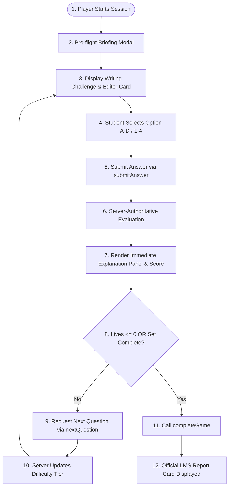

# WriteWise: Professional Writing Challenge (`writewise-challenge`)

**WriteWise: Professional Writing Challenge** is an autonomous, gamified writing assessment plugin for the **Winners Creek Learning Management System (LMS)**. Designed to blend Duolingo-style bite-sized learning mechanics with high-fidelity professional workplace writing scenarios, the plugin elevates students' written communication, diplomatic nuance, and workplace polish without generic multiple-choice drudgery.

---

## 1. Game Concept & Purpose

In modern business environments, poor email etiquette, convoluted phrasing, aggressive tone, and grammatical lapses directly impede career advancement. **WriteWise** puts the student in the shoes of an executive communicator who must resolve real-world communications across Slack, email threads, customer disputes, and leadership summaries.

- **Game Name**: WriteWise: Professional Writing Challenge
- **Plugin Slug**: `writewise-challenge`
- **Category**: `Writing & Professional Communication`
- **Default Difficulty**: `BEGINNER`
- **Duration**: ~12–15 Minutes (900 seconds)
- **XP Reward**: 200 XP
- **Target Audience**: Undergraduate students, job seekers, and corporate apprentices.

---

## 2. EEDI Competency Mapping

The plugin directly assesses competencies within the **Employability & Executive Development Index (EEDI)**:

| Competency Code | Competency Name | Pillar | Role in WriteWise |
| :--- | :--- | :--- | :--- |
| **`COM08`** | **Written Communication** | Communication | **Primary Anchor**: Core business email composition, syntax, and grammatical clarity. |
| **`COM05`** | **Clarity & Conciseness** | Communication | **Secondary**: Eliminating corporate bloat, redundancies, and passive verbosity. |
| **`COM02`** | **Vocabulary & Professional Tone** | Communication | **Secondary**: Distinguishing polite disagreement, executive presence, and tone control. |
| **`COM04`** | **Reading Comprehension** | Communication | **Secondary**: Interpreting client requests, urgency, and implicit expectations. |

---

## 3. Core Gameplay & 6 Challenge Types

The game features six distinct writing challenges, rendered within a modern IDE/document simulation canvas:

### Challenge Type 1 — Fix the Sentence (`fix_the_sentence`)
- **Objective**: Identify grammar, spelling, punctuation, or subject-verb agreement mistakes.
- **Example**: *"Yesterday i go to market and buy some fruits. it was very crowded."*
- **Correction**: *"Yesterday I went to the market and bought some fruit; it was very crowded."*

### Challenge Type 2 — Professional Rewrite (`professional_rewrite`)
- **Objective**: Transform casual, slangy, or unpolished messages into courteous business communication.
- **Example**: *"hey sir i can't come office today coz i'm not feeling good"*
- **Correction**: *"Good morning, I am writing to inform you that I am unwell today and unable to attend work. I will keep you updated on my availability."*

### Challenge Type 3 — Tone Detective (`tone_detective`)
- **Objective**: Analyze workplace messages to detect emotional tone (Aggressive, Passive-Aggressive, Casual, or Professional).
- **Example**: *"Per my previous email, as I already explained twice, the instructions are documented on page 4."*
- **Identification**: *Passive-Aggressive & Impatient*.

### Challenge Type 4 — Sentence Builder (`sentence_builder`)
- **Objective**: Reassemble scrambled phrase fragments into fluent, parallel business syntax.
- **Example**: *"please / report / review / before / meeting / the"*
- **Correct Formulation**: *"Please review the report before the meeting."*

### Challenge Type 5 — Concise Writing (`concise_writing`)
- **Objective**: Strip out redundant qualifiers and bloated corporate jargon without losing meaning.
- **Example**: *"Due to the fact that we are currently experiencing a significant lack of adequate resources, it is necessary that we postpone."*
- **Concise Version**: *"Because we lack sufficient resources, we must postpone the milestone."*

### Challenge Type 6 — Email Response (`email_response`)
- **Objective**: Given a high-stakes scenario (scope creep, delayed deliverables, contract disputes), choose the response that balances tact, professionalism, clarity, and boundaries.

---

## 4. Game Loop



1. **Start**: Student launches game from `/student/games/[id]/play`.
2. **Briefing**: Displays competencies, rules, XP rewards, and estimated duration.
3. **Challenge Presentation**: Editor canvas highlights scenario, draft excerpt, line numbers, and typing animation.
4. **Answer Selection**: Click or press keyboard shortcuts (`1`–`4` or `A`–`D`).
5. **Submission**: Dispatched via `props.submitAnswer(optionIndex, latencyMs)`.
6. **Feedback**: Duolingo-style feedback card highlights accuracy, points breakdown, and deep educational explanation.
7. **Adaptive Progress**: Server monitors 5-question rolling window and updates difficulty.
8. **Completion**: Finalizes exclusively via `props.completeGame()`. **Never** uses `router.push()` or `window.location.href`.

---

## 5. Scoring & Platform Multipliers

Scoring is calculated strictly by the authoritative LMS backend:

$$\text{PointsEarned} = \text{BaseScore} \times \text{TierMultiplier} \times \text{Weight} + \text{SpeedBonus}$$

- **Base Score**: 100 points for correct answer (0 if incorrect).
- **Tier Multipliers**:
  - `BEGINNER`: 1.0x (Warm Up)
  - `INTERMEDIATE`: 1.25x (Workplace Pro)
  - `ADVANCED`: 1.5x (Executive Writer)
- **Question Weight**: Configured per question in CSV (`1.0` to `1.5`).
- **Speed Bonus**: +20 points awarded when response time $\le 15,000\text{ ms}$ (15 seconds).

---

## 6. Lives System

- **Default Lives**: 3 (`❤️ ❤️ ❤️`).
- Incorrect answers decrease lives authoritatively on the server.
- The UI reflects current count directly from `props.lives` or `useGameScore().lives`.
- When lives hit 0 (`❤️ 🖤 🖤` $\to$ `🖤 🖤 🖤`), the session triggers the Game Over state and prompts the student to complete the session and view the Report Card.

---

## 7. Adaptive Difficulty

Difficulty adjustments are managed server-side:
- **Promotion Threshold ($\ge 80\%$)**: 4 or 5 correct answers in a rolling 5-question window promotes the student (`BEGINNER` $\to$ `INTERMEDIATE` $\to$ `ADVANCED`).
- **Demotion Threshold ($< 50\%$)**: Falling below 50% demotes the student to reinforce fundamentals.
- **Visual Feedback**: The `LevelNotification` component automatically flashes a celebratory banner whenever tier transitions occur.

---

## 8. Strategic Hint System

- Students receive **3 strategic writing hints** per attempt.
- Clicking **💡 Hint** opens a context-specific writing advisory card tailored to the challenge type.
- Records the `HINT_USED` telemetry event.

---

## 9. Telemetry Events Emitted

The plugin emits the following structured events via `props.emitEvent`:

| Event Code | Trigger | Sample Payload |
| :--- | :--- | :--- |
| `GAME_STARTED` | Briefing dismissed, timer begins | `{ difficulty: "BEGINNER", durationSeconds: 900 }` |
| `QUESTION_SHOWN` | New challenge rendered | `{ questionId: "WW_BEG_001", difficulty: "BEGINNER", tag: "fix_the_sentence" }` |
| `ANSWER_SELECTED` | Student selects option 0-3 | `{ questionId: "WW_BEG_001", optionIndex: 1 }` |
| `ANSWER_SUBMITTED` | Submit button pressed | `{ questionId: "WW_BEG_001", optionIndex: 1, responseTimeMs: 4200 }` |
| `ANSWER_CORRECT` | Answer validated as correct | `{ questionId: "WW_BEG_001", pointsEarned: 120, streak: 3 }` |
| `ANSWER_WRONG` | Answer validated as incorrect | `{ questionId: "WW_BEG_001", livesRemaining: 2 }` |
| `LIFE_LOST` | Life subtracted | `{ livesRemaining: 2, reason: "WRONG_ANSWER" }` |
| `LEVEL_UP` | Tier promoted by server | `{ fromLevel: "BEGINNER", toLevel: "INTERMEDIATE" }` |
| `LEVEL_DOWN` | Tier demoted by server | `{ fromLevel: "INTERMEDIATE", toLevel: "BEGINNER" }` |
| `HINT_USED` | Hint drawer opened | `{ questionId: "WW_INT_004", hintsRemaining: 2 }` |
| `TIMEOUT` | 15-minute timer hits zero | `{ questionId: "WW_ADV_002" }` |
| `GAME_COMPLETED` | Complete button triggered | `{ finalScore: 840, accuracy: 88, totalAnswered: 8, correctCount: 7 }` |

---

## 10. Question CSV Import Schema

The question bank lives in `apps/game/writewise-challenge/questions.sample.csv` adhering to the LMS standard 14-column format:

```csv
question_id,difficulty,tag,eedi_parameter,weight,scenario,passage,question,option_0,option_1,option_2,option_3,correct_option,explanation
```

- `question_id`: Unique identifier (e.g., `WW_BEG_001`).
- `difficulty`: `BEGINNER`, `INTERMEDIATE`, or `ADVANCED`.
- `tag`: One of the 6 challenge types (`fix_the_sentence`, `professional_rewrite`, `tone_detective`, `sentence_builder`, `concise_writing`, `email_response`).
- `eedi_parameter`: `COM08`, `COM05`, `COM02`, or `COM04`.
- `weight`: `1.0` to `1.5`.
- `scenario`: Background context for the scenario.
- `passage`: Raw draft, unpolished sentence, or email snippet.
- `question`: Clear task directive.
- `option_0` to `option_3`: 4 distinct choices.
- `correct_option`: Zero-indexed integer (`0`, `1`, `2`, or `3`).
- `explanation`: Educational reasoning highlighting why the chosen option is effective.

---

## 11. Testing & Validation Guide

To synchronize and test the plugin:

1. **Run the Autonomous Discovery Scanner**:
   ```bash
   node scripts/sync-games.mjs
   ```
   *Expected Output*:
   ```text
   [sync-games] Discovered 1 valid game plugin(s):
     - writewise-challenge: WriteWise: Professional Writing Challenge
   [sync-games] Wrote 1 plugin(s) to .../apps/game/generated_plugins.ts
   [sync-games] All plugins passed manifest and AST security checks.
   ```

2. **Run TypeScript Typecheck**:
   ```bash
   npm --prefix apps/web run typecheck
   ```

3. **Run Production Build**:
   ```bash
   npm --prefix apps/web run build
   ```

4. **Verify Zero-Touch Architecture**:
   Confirm that only files inside `apps/game/writewise-challenge/` were created for this game plugin, satisfying the golden rule: **ONE FOLDER, ZERO LMS TOUCHES.**
