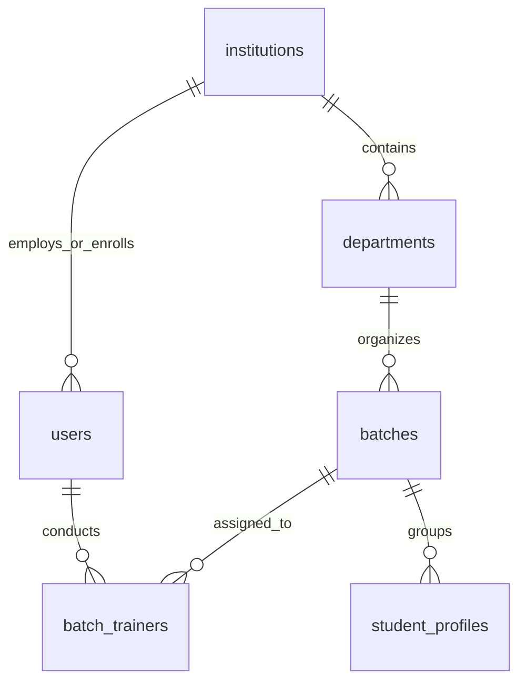
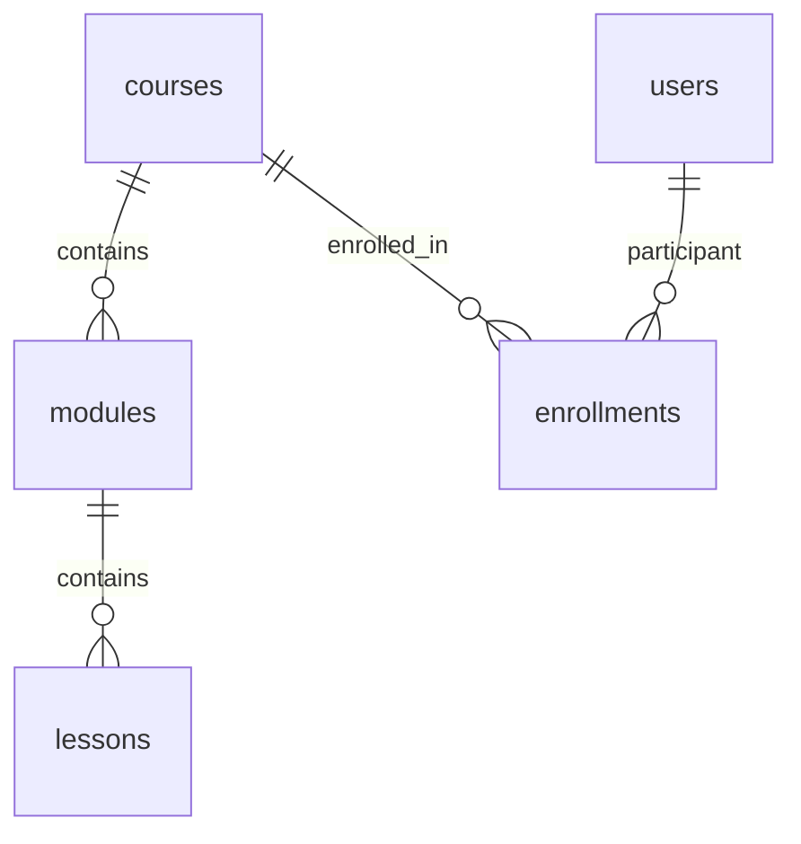
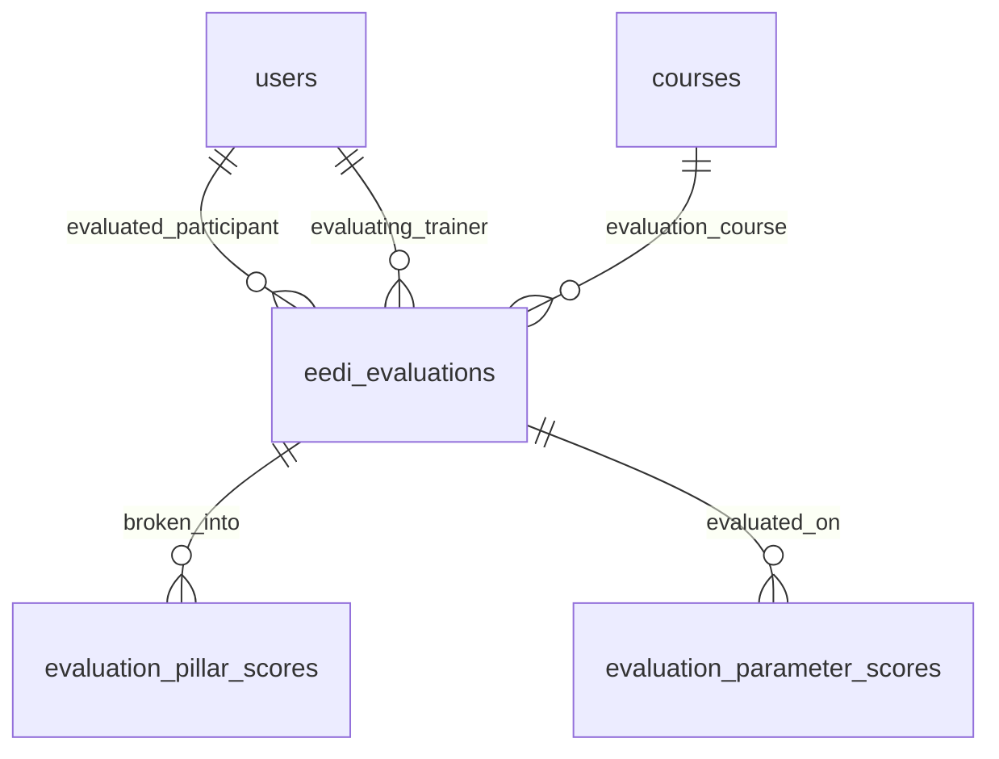

# Arya College of Engineering & IT — Database Schema Reference

## Overview
The Winners Creek LMS platform utilizes **PostgreSQL** (`cnc` database on port 5432) as its primary relational system of record for all institutional tenancy, authentication, user profiles, academic batches, course curriculums, enrollments, attendance, payments, and EEDI evaluations.

---

## 1. Institutional Tenancy & Academic Hierarchy

### 1.1 `institutions`
- `id` (UUID, PK, default `gen_random_uuid()`)
- `name` (VARCHAR, NOT NULL) — e.g. `'Arya College of Engineering and IT'`
- `code` (VARCHAR, UNIQUE, NOT NULL) — e.g. `'ACEIT'`
- `institution_type` (VARCHAR, default `'COLLEGE'`)
- `training_type` (VARCHAR, default `'COLLEGE'`)
- `city` (VARCHAR), `state` (VARCHAR), `country` (VARCHAR)
- `status` (VARCHAR, default `'ACTIVE'`)
- `created_at`, `updated_at` (TIMESTAMPTZ, default `NOW()`)

### 1.2 `departments`
- `id` (UUID, PK)
- `institution_id` (UUID, FK $\rightarrow$ `institutions.id` ON DELETE RESTRICT)
- `name` (VARCHAR, NOT NULL) — e.g. `'Computer Science & Engineering'`
- `code` (VARCHAR, NOT NULL) — e.g. `'CSE'`, `'IT'`, `'AI&DS'`
- `status` (VARCHAR, default `'ACTIVE'`)
- **Constraints**: `UNIQUE (institution_id, code)`

### 1.3 `batches`
- `id` (UUID, PK)
- `institution_id` (UUID, FK $\rightarrow$ `institutions.id`)
- `department_id` (UUID, FK $\rightarrow$ `departments.id`)
- `name` (VARCHAR, NOT NULL) — e.g. `'Batch 2025-29 Sem 3 CS-A'`
- `code` (VARCHAR, NOT NULL) — e.g. `'2025-29-III-CS-A'`
- `academic_year` (VARCHAR) — e.g. `'2025-2029'`, `'2023-2027'`
- `semester` (INTEGER, NOT NULL) — `3` or `7`
- `status` (VARCHAR, default `'ACTIVE'`)
- **Constraints**: `UNIQUE (institution_id, code)`

### 1.4 `batch_trainers`
- `batch_id` (UUID, FK $\rightarrow$ `batches.id` ON DELETE CASCADE)
- `trainer_user_id` (UUID, FK $\rightarrow$ `users.id` ON DELETE CASCADE)
- `created_at` (TIMESTAMPTZ)
- **Constraints**: `PRIMARY KEY (batch_id, trainer_user_id)`

---

## 2. Authentication & User Profile Hierarchy

### 2.1 `users`
- `id` (UUID, PK)
- `email` (VARCHAR, UNIQUE, NOT NULL)
- `password_hash` (VARCHAR, NOT NULL)
- `name` (VARCHAR, NOT NULL)
- `role` (user_role_enum: `'SUPER_ADMIN'`, `'ADMIN'`, `'HOD'`, `'TRAINER'`, `'STUDENT'`)
- `institution_id` (UUID, FK $\rightarrow$ `institutions.id`, NULLABLE for SUPER_ADMIN)
- `department_id` (UUID, FK $\rightarrow$ `departments.id`, NULLABLE)
- `phone` (VARCHAR, NULLABLE)
- `status` (VARCHAR, default `'ACTIVE'`, values: `'ACTIVE'`, `'INACTIVE'`, `'ARCHIVED'`)
- `created_at`, `updated_at` (TIMESTAMPTZ)

### 2.2 `student_profiles`
- `id` (UUID, PK)
- `user_id` (UUID, UNIQUE, FK $\rightarrow$ `users.id` ON DELETE CASCADE)
- `roll_number` (VARCHAR, NOT NULL) — e.g. `'25EARCS001'`
- `institution_id` (UUID, FK $\rightarrow$ `institutions.id`)
- `department_id` (UUID, FK $\rightarrow$ `departments.id`)
- `batch_id` (UUID, FK $\rightarrow$ `batches.id`)
- `branch` (VARCHAR, NOT NULL) — `'CSE'`, `'IT'`, `'AI&DS'`
- `section` (VARCHAR, NOT NULL) — `'CS-A'`, `'IT-B'`, `'AI&DS-A'`, etc.
- `current_semester` (INTEGER, NOT NULL) — `3` or `7`
- `academic_year` (VARCHAR, NOT NULL) — `'2025-2029'` or `'2023-2027'`
- `is_hosteler` (BOOLEAN, default `FALSE`)
- `avatar_url` (VARCHAR, NULLABLE)
- `created_at`, `updated_at` (TIMESTAMPTZ)
- **Constraints**: `UNIQUE (institution_id, roll_number)`

---

## 3. Course Catalog & Curriculums

### 3.1 `courses`
- `id` (UUID, PK)
- `title` (VARCHAR, NOT NULL) — e.g. `'Soft Skills – Arya Old'`
- `slug` (VARCHAR, UNIQUE, NOT NULL) — e.g. `'soft-skills-arya-old'`
- `code` (VARCHAR, UNIQUE, NOT NULL) — e.g. `'SS-ARYA-OLD'`
- `description` (TEXT)
- `category` (VARCHAR, default `'Soft Skills'`)
- `training_type` (VARCHAR, default `'COLLEGE'`)
- `delivery_mode` (VARCHAR, default `'BLENDED'`)
- `duration_hours` (INTEGER, NOT NULL)
- `fee` (NUMERIC(10,2), default `4999.00`)
- `published` (BOOLEAN, default `TRUE`)
- `order_index` (INTEGER, default `1`)
- `deleted_at` (TIMESTAMPTZ, NULLABLE)

### 3.2 `modules`
- `id` (UUID, PK)
- `course_id` (UUID, FK $\rightarrow$ `courses.id` ON DELETE CASCADE)
- `title` (VARCHAR, NOT NULL)
- `slug` (VARCHAR, NOT NULL)
- `description` (TEXT)
- `order_index` (INTEGER, NOT NULL)
- `created_at`, `updated_at`, `deleted_at` (TIMESTAMPTZ)

### 3.3 `lessons`
- `id` (UUID, PK)
- `module_id` (UUID, FK $\rightarrow$ `modules.id` ON DELETE CASCADE)
- `title` (VARCHAR, NOT NULL)
- `slug` (VARCHAR, NOT NULL)
- `duration_minutes` (INTEGER, default `30`)
- `order_index` (INTEGER, NOT NULL)
- `content_type` (VARCHAR, default `'VIDEO'`, values: `'VIDEO'`, `'INTERACTIVE'`, `'READING'`, `'PRACTICE'`, `'QUIZ'`)
- `content` (TEXT)

---

## 4. Enrollments, Annual Fee Policy & Payments

### 4.1 `enrollments`
- `id` (UUID, PK)
- `participant_user_id` (UUID, FK $\rightarrow$ `users.id`)
- `course_id` (UUID, FK $\rightarrow$ `courses.id`)
- `institution_id` (UUID, FK $\rightarrow$ `institutions.id`)
- `department_id` (UUID, FK $\rightarrow$ `departments.id`)
- `batch_id` (UUID, FK $\rightarrow$ `batches.id`)
- `current_semester` (INTEGER, NOT NULL)
- `enrollment_status` (VARCHAR, default `'ACTIVE'`)
- `payment_status` (VARCHAR, default `'PENDING'`, values: `'PENDING'`, `'VERIFIED'`, `'OVERDUE'`)
- `access_status` (VARCHAR, default `'ACTIVE'`, values: `'ACTIVE'`, `'INACTIVE'`, `'EXPIRED'`)
- `access_start_date` (DATE)
- `access_end_date` (DATE)
- **Constraints**: `UNIQUE (participant_user_id, course_id)`

### 4.2 `enrollment_periods`
Tracks semester-by-semester validity and access rights:
- `id` (UUID, PK)
- `enrollment_id` (UUID, FK $\rightarrow$ `enrollments.id` ON DELETE CASCADE)
- `participant_user_id` (UUID, FK $\rightarrow$ `users.id`)
- `course_id` (UUID, FK $\rightarrow$ `courses.id`)
- `semester` (INTEGER, NOT NULL) — `1` through `8`
- `start_date` (DATE), `end_date` (DATE)
- `access_status` (VARCHAR)
- `payment_status` (VARCHAR)
- **Constraints**: `UNIQUE (participant_user_id, course_id, semester)`

### 4.3 `payments`
- `id` (UUID, PK)
- `enrollment_id` (UUID, FK $\rightarrow$ `enrollments.id` ON DELETE CASCADE)
- `participant_user_id` (UUID, FK $\rightarrow$ `users.id`)
- `course_id` (UUID, FK $\rightarrow$ `courses.id`)
- `semester` (INTEGER, NOT NULL)
- `amount` (NUMERIC(10,2), NOT NULL) — `4999.00`
- `currency` (VARCHAR, default `'INR'`)
- `transaction_ref` (VARCHAR, UNIQUE, NOT NULL)
- `payment_method` (VARCHAR, default `'COLLEGE_OFFICIAL_FEE'`)
- `status` (VARCHAR, default `'VERIFIED'`)
- `verified_by` (UUID, FK $\rightarrow$ `users.id`)
- `verified_at` (TIMESTAMPTZ)
- `notes` (TEXT)
- **Check Constraints**: `chk_payment_verification_audit CHECK ((status != 'VERIFIED') OR (verified_at IS NOT NULL))`

---

## 5. Attendance & Training Sessions

### 5.1 `training_sessions`
- `id` (UUID, PK)
- `institution_id` (UUID, FK $\rightarrow$ `institutions.id`)
- `department_id` (UUID, FK $\rightarrow$ `departments.id`)
- `batch_id` (UUID, FK $\rightarrow$ `batches.id`)
- `trainer_user_id` (UUID, FK $\rightarrow$ `users.id`)
- `topic` (VARCHAR, NOT NULL) — e.g. `'Soft Skills Summer Training'`
- `session_date` (DATE, NOT NULL)
- `starts_at` (TIMESTAMPTZ, NOT NULL)
- `ends_at` (TIMESTAMPTZ, NOT NULL)
- `status` (VARCHAR, default `'COMPLETED'`)
- **Check Constraints**: `CHECK (ends_at >= starts_at)`

### 5.2 `attendance_records`
- `id` (UUID, PK)
- `session_id` (UUID, FK $\rightarrow$ `training_sessions.id` ON DELETE CASCADE)
- `participant_user_id` (UUID, FK $\rightarrow$ `users.id`)
- `status` (attendance_status_enum: `'PRESENT'`, `'ABSENT'`, `'LATE'`, `'EXCUSED'`)
- `marked_by` (UUID, FK $\rightarrow$ `users.id`)
- `marked_at` (TIMESTAMPTZ, default `NOW()`)
- **Constraints**: `UNIQUE (session_id, participant_user_id)`

---

## 6. EEDI Evaluations & Employability Scoring

### 6.1 `eedi_evaluations`
- `id` (UUID, PK)
- `participant_user_id` (UUID, FK $\rightarrow$ `users.id`)
- `trainer_user_id` (UUID, FK $\rightarrow$ `users.id`)
- `institution_id` (UUID, FK $\rightarrow$ `institutions.id`)
- `department_id` (UUID, FK $\rightarrow$ `departments.id`)
- `course_id` (UUID, FK $\rightarrow$ `courses.id`)
- `semester` (INTEGER, NOT NULL) — e.g. `7`
- `status` (evaluation_status_enum: `'PENDING'`, `'IN_PROGRESS'`, `'COMPLETED'`)
- `eedi_score` (NUMERIC(5,2)) — Scale `0` to `100`
- `employment_score` (NUMERIC(5,2)) — Scale `0` to `100`
- `trainer_notes` (TEXT)
- `strengths` (TEXT[]), `weaknesses` (TEXT[]), `improvements` (TEXT[])
- `submitted_at` (TIMESTAMPTZ)
- **Constraints**:
  - `UNIQUE (participant_user_id, course_id, semester)`
  - `CHECK (((eedi_score IS NULL) OR (eedi_score >= 0 AND eedi_score <= 100)) AND ((employment_score IS NULL) OR (employment_score >= 0 AND employment_score <= 100)))`

### 6.2 `evaluation_pillar_scores`
- `id` (UUID, PK)
- `evaluation_id` (UUID, FK $\rightarrow$ `eedi_evaluations.id` ON DELETE CASCADE)
- `pillar` (VARCHAR, NOT NULL) — e.g. `'Communication & Presentation'`
- `score` (NUMERIC(5,2), NOT NULL)
- `max_score` (NUMERIC(5,2), default `100.00`)
- `weight` (NUMERIC(3,2), default `1.00`)
- **Constraints**: `UNIQUE (evaluation_id, pillar)`

