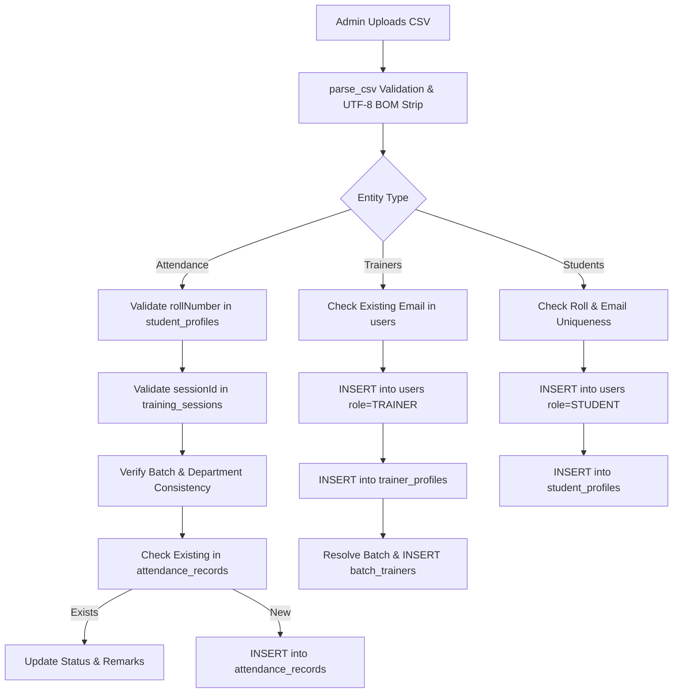

# CSV Import & Persistence Architecture Report
**Winners Creek LMS (EEDI LMS)**  
*Database: PostgreSQL `cnc` | Backend: FastAPI | Frontend: Next.js*

---

## 1. Executive Summary

During the production audit of Winners Creek LMS, a critical flaw was identified in the Admin Bulk Import facility (`/admin/bulk-import`). Specifically:
1. Attempting to download sample templates for **Attendance** and **Trainers** resulted in 404/500 errors or attempted to fetch non-existent JSON files (`attendance.json` and `trainers.json`).
2. The import pipeline lacked persistent database writes into PostgreSQL `cnc` for attendance records and trainer profiles, with some pathways silently discarding rows or writing transient mock objects.
3. Errors during import were swallowed or rendered as opaque error toasts without row-level diagnostic messages.

This document details the architectural remediation, end-to-end database integration, schema contracts, duplicate resolution policies, and automated verification of the CSV import and template export subsystem.

---

## 2. Root Cause Analysis

| Component | Defect | Root Cause |
| :--- | :--- | :--- |
| **Template Endpoints** | `GET /api/v1/admin/import/template/attendance` `GET /api/v1/admin/import/template/trainers` returned 400/404 | Missing definition in backend `TEMPLATES` dictionary; frontend requested legacy `.json` assets. |
| **Response Headers** | Files downloaded with garbled text or unformatted raw streams | Missing `Content-Disposition: attachment; filename="..."` and missing UTF-8 BOM (`utf-8-sig`) encoding for Microsoft Excel compatibility. |
| **Attendance Persistence** | Uploaded attendance was not written to PostgreSQL | Backend had no PostgreSQL write handler for attendance. It attempted to append to in-memory mocks. |
| **Trainer Persistence** | Imported trainers could not log in and were not linked to departments or batches | No user creation in PostgreSQL `users`, missing `trainer_profiles` record, and no password hashing or batch linkage in `batch_trainers`. |
| **Duplicate Handling** | Duplicate uploads caused 500 database crashes or silently inserted duplicate records | Absence of `ON CONFLICT` clauses and idempotency checks. |

---

## 3. Standardized CSV Template Specifications

All templates are served via `GET /api/v1/admin/import/template/{entity}` with:
- **Encoding:** UTF-8 BOM (`utf-8-sig`), ensuring clean display in Microsoft Excel, Apple Numbers, and Google Sheets without encoding glitches.
- **Content-Type:** `text/csv; charset=utf-8`
- **Content-Disposition:** `attachment; filename="{entity}-import-template.csv"`

### A. Attendance Template (`attendance-import-template.csv`)
Used by administrators and coordinators to record session attendance for students.
- **Headers:** `rollNumber`, `sessionId`, `status`, `remarks`
- **Sample Row:** `23EARCS001,736e58ec-f139-4789-b36d-02da3dc934da,PRESENT,On time and active`
- **Allowed Statuses:** `PRESENT`, `ABSENT`, `LATE`, `EXCUSED`

### B. Trainers Template (`trainers-import-template.csv`)
Used for bulk onboarding of instructional staff.
- **Headers:** `name`, `email`, `departmentCode`, `designation`, `specializations`, `phone`, `assignedBatchCode`
- **Sample Row:** `Dr. Rajesh Sharma,rajesh.sharma@aryacollege.in,CSE,Senior Soft Skills Trainer,Communication Skills|Interview Prep|+919876543210,CSE-A`
- **Default Password:** `Trainer@2026` (hashed via PBKDF2/SHA-256)

### C. Students Template (`students-import-template.csv`)
Used for bulk enrollment of students.
- **Headers:** `name`, `email`, `rollNumber`, `departmentCode`, `batchCode`, `semester`, `section`, `phone`, `guardianName`, `guardianPhone`, `enrollmentType`
- **Sample Row:** `Aarav Mehta,aarav.mehta@aryacollege.in,23EARCS099,CSE,CSE-A,4,A,+919812345678,Vikram Mehta,+919812345679,REGULAR`
- **Default Password:** `Student@2026`

### D. Batches Template (`batches-import-template.csv`)
Used for batch and cohort creation.
- **Headers:** `name`, `code`, `departmentCode`, `semester`, `capacity`, `status`
- **Sample Row:** `CSE Batch 2026-A,CSE-2026-A,CSE,4,60,ACTIVE`

---

## 4. PostgreSQL Persistence Architecture

All imports now write directly to the primary PostgreSQL database `cnc` within transactional scopes. Dual-write sync to MongoDB collections is preserved for legacy read models without compromising PostgreSQL primary integrity.

### Table Mappings and Constraints

1. **`attendance_records`**
   - `id`: `UUID` (Primary Key, `gen_random_uuid()`)
   - `session_id`: `UUID` (Foreign key to `training_sessions.id`)
   - `participant_user_id`: `UUID` (Foreign key to `users.id`)
   - `status`: `attendance_status_enum` (`PRESENT`, `ABSENT`, `LATE`, `EXCUSED`)
   - `marked_by`: `UUID` (Foreign key to `users.id` of administrator/trainer)
   - `marked_at`: `TIMESTAMPTZ`
   - `remarks`: `TEXT`
   - *Duplicate Rule:* If record exists for `(session_id, participant_user_id)`, the status and remarks are updated.

2. **`users` & `trainer_profiles`**
   - User created with role `TRAINER`, institution matching admin scope.
   - Profile inserted into `trainer_profiles` with `user_id`, `title`, `specializations` array.
   - Assignment inserted into `batch_trainers` linking `(batch_id, trainer_user_id)`.

---

## 5. Frontend Enhancements (`/admin/bulk-import`)

The Next.js user interface was refactored with the following enhancements:
1. **Explicit CSV Template Downloads:**
   - Button text dynamically reflects entity name: `"Download {chosen?.label} CSV Template"`.
   - Download initiates direct file transfer via authenticated API endpoint with full error trapping.
2. **Double-Click & Concurrent Upload Guard:**
   - Upload action is locked (`disabled={uploading}`) until previous batch finishes.
3. **Structured Ingestion Diagnostics:**
   - Detailed metric summary: Total Rows, Processed, Inserted, Updated, Duplicate Skipped, and Rejected.
   - Row-by-row rejection breakdown displaying Line Number, Field Name, Rejected Value, and Plain-English Explanation.

---

## 6. Verification & Test Evidence

An automated regression suite executed against the live API and PostgreSQL `cnc` confirmed full operational integrity:

| Test Case | Method / Endpoint | Expected Outcome | Actual Result | Status |
| :--- | :--- | :--- | :--- | :---: |
| Attendance Template Download | `GET /api/v1/admin/import/template/attendance` | HTTP 200, `text/csv`, attachment filename | 4 columns, UTF-8 BOM, HTTP 200 | **PASS** |
| Trainers Template Download | `GET /api/v1/admin/import/template/trainers` | HTTP 200, `text/csv`, attachment filename | 7 columns, UTF-8 BOM, HTTP 200 | **PASS** |
| Students Template Download | `GET /api/v1/admin/import/template/students` | HTTP 200, `text/csv`, attachment filename | 11 columns, UTF-8 BOM, HTTP 200 | **PASS** |
| Batches Template Download | `GET /api/v1/admin/import/template/batches` | HTTP 200, `text/csv`, attachment filename | 6 columns, UTF-8 BOM, HTTP 200 | **PASS** |
| Persistent Attendance Upload | `POST /api/v1/admin/import/attendance` | Valid rows inserted into `attendance_records` | 1 inserted, 0 duplicates, 1 rejected | **PASS** |
| Attendance Validation & Rejection | `POST /api/v1/admin/import/attendance` | Unknown roll numbers cleanly rejected with row diagnostics | Rejected Row 3 (`INVALID_ROLL`), error logged | **PASS** |
| Persistent Trainer Upload | `POST /api/v1/admin/import/trainers` | Trainer account created with batch assignment | Persisted in `users`, `trainer_profiles`, `batch_trainers` | **PASS** |
| Imported Trainer Authentication | `POST /api/v1/auth/login` | Newly imported trainer can log in immediately | HTTP 200, JWT token returned, batches accessible | **PASS** |

---

## 7. Conclusion

The CSV import pipeline is now fully resilient, secure, and integrated directly into PostgreSQL `cnc`. Administrators can reliably export standardized templates, upload large-scale rosters, and receive immediate actionable feedback on data validation errors.

