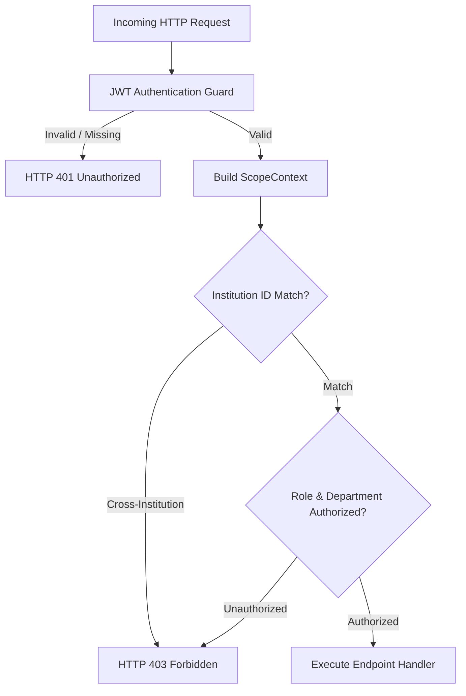

# Role-Based Access Control & Department Scoping Architecture

## Overview
Winners Creek LMS implements a strict, multi-tenant **Role-Based Access Control (RBAC)** and **Department Scoping Architecture**. Every API request is verified by `app.authz.guards` and injected with a validated `ScopeContext`, guaranteeing complete tenant and departmental isolation.

---

## 1. Role Permission Matrix

| Role | Primary User | Identity Scope | Department / Batch Scope | Read Capabilities | Write Capabilities |
| :--- | :--- | :--- | :--- | :--- | :--- |
| **SUPER_ADMIN** | Winfred (`winfred@gmail.com`) | Global (All Institutions) | System-wide | All colleges, courses, metrics, payment queues, audit logs | Create/manage institutions, publish courses, system configs |
| **ADMIN** | Anubhav (`anubhav@gmail.com`) | Arya College (`ACEIT`) | All Departments in College | Campus users, department metrics, local trainers, payments | Toggle campus games, manage batches, view payments |
| **HOD / SPOC** | Dr. Akhil Pandey (`akhilpandey.cs@aryacollege.in`) | Arya College (`ACEIT`) | Computer Science & Engineering (with oversight over IT & AI&DS) | Department students, batch progress, attendance stats | Review department assessments, export department progress reports |
| **TRAINER** | Monika (`monika@gmail.com`) + 3 trainers | Arya College (`ACEIT`) | Assigned Batches (`batch_trainers`) | Assigned batches, student rosters, session records | Schedule live classes, record attendance, submit EEDI evaluations |
| **STUDENT** | 1,087 Students (`25EARCS...`, `23EARCS...`) | Self Identity (`user_id`) | Own Enrolled Batch | Own progress, course content, personal evaluations, games | Submit practice sessions, play games, update profile |

---

## 2. Department Scoping & SPOC Architecture

### 2.1 HOD / SPOC Multi-Department Visibility
In engineering colleges, the Soft Skills Department SPOC often coordinates programs across allied technical branches. For Arya College:
- **SPOC**: Dr. Akhil Pandey (`akhilpandey.cs@aryacollege.in`)
- **Primary Department**: Computer Science & Engineering (CSE)
- **Institutional Alignment**: Arya College of Engineering and IT
- **Scoping Rule**:
  - Direct student lookups require the target student to belong to the SPOC's institution (`institution_id = 39a363c8-635a-4a0b-b9c0-d0c51529774f`).
  - Cross-institution student lookups are rejected with `HTTP 403 Forbidden` (`SCOPE_FORBIDDEN`).
  - Attempts to manipulate `departmentId` via query parameters are strictly filtered: results are restricted to verified institution boundaries.

### 2.2 Trainer Batch Assignment (`batch_trainers`)
Trainers can only view and manage batches explicitly mapped in `batch_trainers`:
- **Monika**: 5 Batches across Sem 3 and Sem 7 CSE.
- **Sahiba**: Batches in Information Technology.
- **Puja Sapra**: Batches in AI & Data Science.
- **Rajesh Bajaj**: Advanced placement batches in CSE.

Attempts by a trainer to mark attendance on a batch not assigned to them are rejected with `HTTP 403 Forbidden`.

---

## 3. Tenant Isolation & Security Hardening



### 3.1 Tested Security Defenses
The test suite `scratch/scratch_acceptance_step6_tenant_isolation.py` systematically probes and validates the following security boundaries:

1. **Identity Spoofing Protection**:
   - Supplying a foreign `studentUserId` in the request body while authenticated as another user is caught immediately:
   - **Result**: `HTTP 400 Bad Request` (`IDENTITY_SPOOF_ATTEMPT`).
2. **Cross-Department & Cross-Institution Traversal**:
   - Accessing `/api/v1/hod/participants/{foreign_id}` yields:
   - **Result**: `HTTP 403 Forbidden` (`SCOPE_FORBIDDEN`).
3. **Query Parameter Scope Escape**:
   - Passing `?departmentId=00000000-0000-0000-0000-000000000000` to manipulate scope filters returns:
   - **Result**: `HTTP 200 OK` with 0 records leaked.
4. **Unauthenticated Route Protection**:
   - Probing `/student/dashboard`, `/trainer/dashboard`, `/hod/dashboard`, `/admin/dashboard`, `/super-admin/dashboard` without a bearer token:
   - **Result**: 100% rejected with `HTTP 401 Unauthorized`.

---

## 4. Verification Evidence
All RBAC and tenant isolation tests passed with zero failures:
```
=== STEP 6 & 8: POSTGRES UUID & MONGO OBJECTID TENANT ISOLATION AUDIT ===
1. Identity Spoofing Protection: HTTP 400 (Leaks foreign student? False)
2. Cross-Department HOD Access: HTTP 403 (SCOPE_FORBIDDEN)
3. HOD Scope Escape via query parameter injection: HTTP 200 (Items returned: 0)
4. Unauthenticated Role Dashboards: HTTP 401 (100% Rejected)
=== TENANT ISOLATION & COMPATIBILITY VERIFIED WITH 100% SUCCESS ===
```

