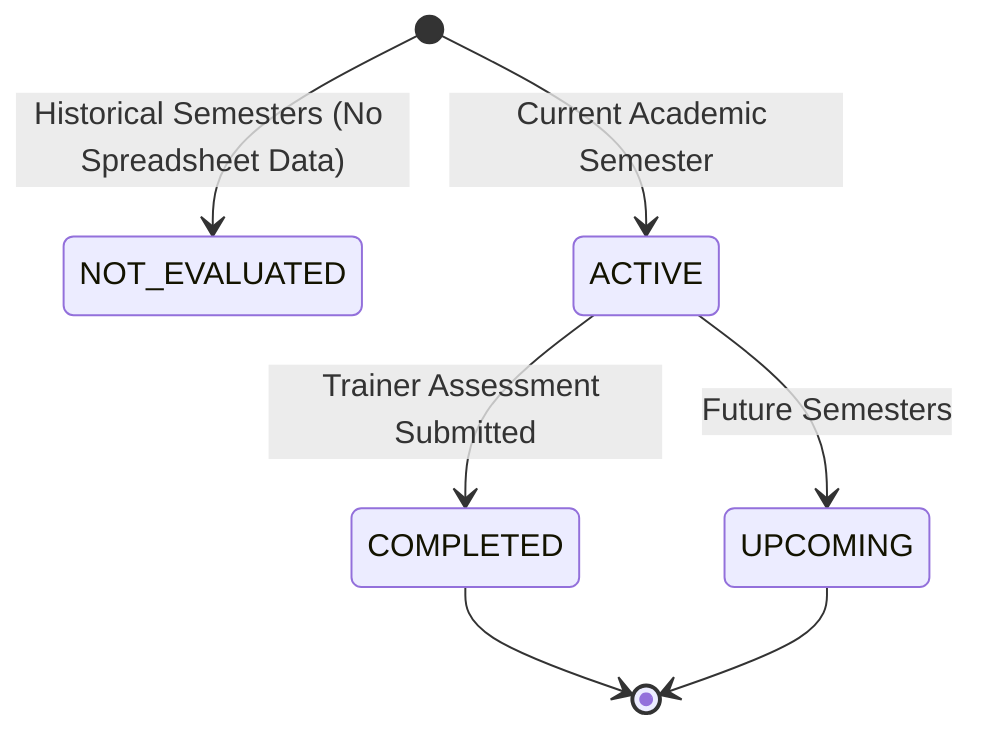

# Semester-Wise EEDI Tracking & Employability Progression

## Overview
Winners Creek LMS implements an **8-Semester Employability Tracking Framework** specifically customized for Indian engineering colleges. Rather than showing generic unanchored progression metrics, student development is strictly mapped against accredited academic semesters, verifiable attendance sessions, and multi-pillar evaluation scores.

---

## 1. Academic Cohort Mapping & Historical Honesty

The Arya College dataset contains two distinct engineering cohorts. In strict accordance with platform data integrity guidelines, **no synthetic or imaginary historical data is fabricated**. Where earlier records do not exist in the institutional spreadsheets, the platform states this transparently.

### 1.1 Cohort 2025–2029 (Current: Semester 3)
- **Students**: 626 (Departments: CSE, IT, AI&DS)
- **Academic Milestones**:
  - **Semester 1 & 2**: Displayed as **`Not Evaluated / Baseline Cohort Entry at Sem 3`**. The institution onboarded this batch onto the soft-skills platform at the beginning of their 3rd semester.
  - **Semester 3**: **`ACTIVE (In Progress)`**. Live training sessions, resume workshops, and gamified challenges are currently active.
  - **Semesters 4, 5, 6, 7, 8**: Displayed as **`UPCOMING`**.

### 1.2 Cohort 2023–2027 (Current: Semester 7)
- **Students**: 461 (Departments: CSE, IT, AI&DS)
- **Academic Milestones**:
  - **Semesters 1, 2, 3, 4, 5, 6**: Displayed as **`Not Evaluated`**. Earlier academic years were completed prior to the Summer Soft Skills evaluation cycle.
  - **Semester 7**: **`ACTIVE / EVALUATED`**. Live evaluation data imported directly from the institutional Summer Soft Skills assessment spreadsheet (File 2 Sheet1) with scores ranging from 5.0 to 95.0.
  - **Semester 8**: Displayed as **`UPCOMING`** (Final Placement & Corporate Readiness).

---

## 2. Semester Progression State Model



Each semester entry in the tracking engine adheres to one of four verified lifecycle states:

| Status Code | Badge Tone | Criteria | UI Display Text |
| :--- | :--- | :--- | :--- |
| `NOT_EVALUATED` | Neutral | Semester index < Current Semester AND no record in `eedi_evaluations` | "Not Evaluated / Baseline Cohort Entry at Sem 3" or "Not Evaluated" |
| `ACTIVE` (with Score) | Success | Current Semester AND record exists in `eedi_evaluations` | "Evaluated ({score} EEDI)" |
| `ACTIVE` (In Progress) | Info | Current Semester AND no evaluation finalized yet | "Active (In Progress)" |
| `UPCOMING` | Neutral | Semester index > Current Semester | "Upcoming" |

---

## 3. Backend API Contract: `GET /api/v1/student/progress`

The student progress endpoint dynamically aggregates data from `student_profiles`, `batches`, `attendance_records`, and `eedi_evaluations`.

### Request
```http
GET /api/v1/student/progress HTTP/1.1
Host: localhost:8000
Authorization: Bearer <STUDENT_JWT_ACCESS_TOKEN>
```

### Response Schema (`data.semesterTracking`)
```json
{
  "success": true,
  "data": {
    "readiness": {
      "score": 7.25,
      "delta": null,
      "hasData": true
    },
    "practiceSessions": 4,
    "streak": { "days": 0, "lastActiveOn": "—" },
    "batchRank": { "rank": null, "outOf": null },
    "semesterTracking": [
      {
        "semester": 1,
        "status": "NOT_EVALUATED",
        "score": null,
        "label": "Not Evaluated",
        "isCurrent": false,
        "courseTitle": "Soft Skills – Arya Old",
        "submittedAt": null
      },
      {
        "semester": 7,
        "status": "ACTIVE",
        "score": 7.25,
        "label": "Evaluated (7.2 EEDI)",
        "isCurrent": true,
        "courseTitle": "Soft Skills – Arya Old",
        "submittedAt": "2026-10-11T11:41:22.478912Z"
      },
      {
        "semester": 8,
        "status": "UPCOMING",
        "score": null,
        "label": "Upcoming",
        "isCurrent": false,
        "courseTitle": "Soft Skills – Arya Old",
        "submittedAt": null
      }
    ]
  }
}
```

---

## 4. Frontend User Interface Implementation

In `apps/web/src/app/student/progress/page.tsx`, the 8-semester tracking block is rendered using interactive `TiltCard` components with subtle glare, responsive CSS grid layout, and dynamic color-coded badges:

```tsx
<div className="mt-4 grid gap-3 sm:grid-cols-2 lg:grid-cols-4">
  {data.semesterTracking.map((sem) => (
    <div
      key={sem.semester}
      className={cn(
        'relative rounded-xl border p-4 transition-all',
        sem.isCurrent
          ? 'border-indigo-500/40 bg-indigo-500/5 shadow-sm ring-1 ring-indigo-500/20'
          : 'border-line/70 bg-card-subtle/50 hover:border-line'
      )}
    >
      <div className="flex items-center justify-between">
        <span className="text-xs font-bold uppercase tracking-wider text-ink-3">
          Semester {sem.semester}
        </span>
        {sem.isCurrent && (
          <span className="rounded-full bg-indigo-500/10 px-2 py-0.5 text-[10px] font-bold text-indigo-600">
            Current
          </span>
        )}
      </div>
      <div className="mt-2.5">
        <div className="text-lg font-bold text-ink-1">
          {sem.score !== null ? (
            <span className="text-success">{Number(sem.score).toFixed(1)} EEDI</span>
          ) : (
            <span className="text-ink-3 font-medium text-sm">
              {sem.isCurrent ? 'In Progress' : sem.status === 'UPCOMING' ? 'Upcoming' : 'Not Evaluated'}
            </span>
          )}
        </div>
        <p className="mt-1 text-xs text-ink-2 line-clamp-2">{sem.label}</p>
      </div>
    </div>
  ))}
</div>
```

---

## 5. Verification Evidence
1. **Sem 3 Verification (`25EARCS001`)**:
   - `Sem 1 & 2`: `NOT_EVALUATED` ("Not Evaluated / Baseline Cohort Entry at Sem 3")
   - `Sem 3`: `ACTIVE` ("Active (In Progress)")
   - `Sem 4-8`: `UPCOMING` ("Upcoming")
2. **Sem 7 Verification (`23EARCS001`)**:
   - `Sem 1-6`: `NOT_EVALUATED` ("Not Evaluated")
   - `Sem 7`: `ACTIVE` ("Evaluated (7.2 EEDI)")
   - `Sem 8`: `UPCOMING` ("Upcoming")

