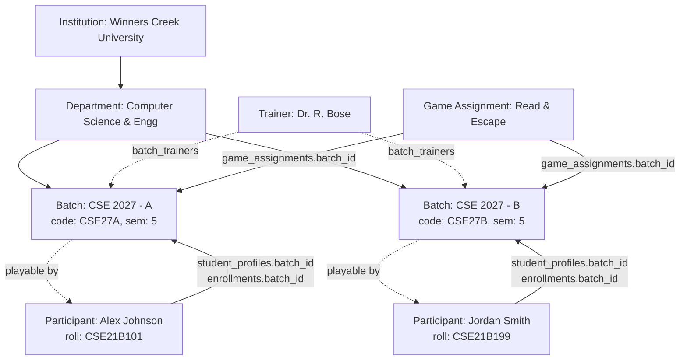

# WINNERS CREEK LMS — BATCH, PARTICIPANT & TRAINER RELATIONSHIP AUDIT

## 1. Executive Summary

This forensic audit and verification report resolves the critical data model and UI consistency issues identified in the Winners Creek LMS between **Batches**, **Participants**, and **Trainers**:

1. **Participant Profile Anomaly**: In Participant Portal (`/student/profile`), Alex Johnson (`CSE21B101`) was displaying `Batch: —`, `Semester: —`, `Section: —`, and `Program: —`.
2. **Trainer Batch Roster Anomaly**: In Trainer Portal (`/trainer/batches`), CSE 2027 - A and CSE 2027 - B displayed `1 Student`, but clicking **Roster** (`/trainer/batches/[batchId]`) rendered an empty list (`0 items`).
3. **Canonical Relationship Truth**: A single, authoritative relational hierarchy was established in PostgreSQL (`cnc`) connecting:
   $$\text{Institution} \longrightarrow \text{Department} \longrightarrow \text{Batch} \longrightarrow \text{Participant Profile / Enrollment} \longrightarrow \text{Trainer Assignment} \longrightarrow \text{Game Assignment}$$
4. **Terminology Compliance**: User-facing UI labels were aligned with standard enterprise LMS naming conventions:
   - Visible `"Student"` replaced with **`"Participant"`**.
   - Visible `"HOD"` replaced with **`"SPOC"`**.

---

## 2. Root Cause Analysis

### Anomaly A: Participant Profile Missing Batch & Semester
- **Location**: [`apps/api/app/routers/student.py: _profile()`](file:///c:/Users/SANDEEP/Desktop/eedi-lms/apps/api/app/routers/student.py)
- **Root Cause**: In PostgreSQL mode, `_profile()` executed:
  ```sql
  SELECT u.id, u.name, u.email, u.phone, u.institution_id, u.department_id,
         sp.roll_number, sp.batch_id, sp.avatar_url,
         d.name as department_name, inst.name as institution_name
  FROM users u
  LEFT JOIN student_profiles sp ON sp.user_id = u.id
  LEFT JOIN departments d ON d.id = u.department_id
  LEFT JOIN institutions inst ON inst.id = u.institution_id
  WHERE u.id = $1::uuid
  ```
  The query selected `sp.batch_id` but **never joined the `batches` or `enrollments` tables**. As a result, the returned dictionary contained only `batchId: "<uuid>"`, while `batchName`, `batchCode`, `semester`, `academicYear`, `section`, and `program` were omitted entirely.
- **Frontend Impact**: [`apps/web/src/app/student/profile/page.tsx`](file:///c:/Users/SANDEEP/Desktop/eedi-lms/apps/web/src/app/student/profile/page.tsx) accessed `data.profile.batchName ?? '—'` and `data.profile.semester ?? '—'`, which defaulted to `—`.

### Anomaly B: Trainer Roster Empty Despite "1 Student" Count
- **Location**: [`apps/api/app/routers/trainer.py: batch_students()`](file:///c:/Users/SANDEEP/Desktop/eedi-lms/apps/api/app/routers/trainer.py)
- **Root Cause**: The Trainer Batch list endpoint (`GET /api/v1/trainer/batches`) was querying PostgreSQL (`batches` joined with `batch_trainers` and computing `(SELECT COUNT(*) FROM student_profiles sp WHERE sp.batch_id = b.id) as student_count`), which yielded `1` for both `CSE 2027 - A` and `CSE 2027 - B`.
  However, the roster endpoint (`GET /api/v1/trainer/batches/{batch_id}/students`) had **no PostgreSQL implementation** and fell back to `StudentProfileRepo(ctx).list(filters={"batchId": resolved})`. Because MongoDB runs an empty in-process memory store in local development, it returned `[]`.
- **Scope Guard Impact**: In [`apps/api/app/authz/guards.py: require_student_in_scope()`](file:///c:/Users/SANDEEP/Desktop/eedi-lms/apps/api/app/authz/guards.py), student lookup was checking MongoDB via `get_db().student_profiles.find_one(...)`, causing participant authorization checks to fail or return 403/404 for valid PostgreSQL UUIDs.

---

## 3. Canonical Relational Architecture

The system now enforces **one authoritative source of truth** in PostgreSQL (`cnc`):



### PostgreSQL Truth Matrix
| Entity | Identifier / Record | Relationship Key | Target |
| :--- | :--- | :--- | :--- |
| **Institution** | `5f2fce16-149e-430b-991f-9ea13b29dd29` | `name` | Winners Creek University |
| **Department** | `1e8a74c6-c78f-4518-9588-6f0f51df3aad` | `code`, `name` | CSE, Computer Science & Engineering |
| **Batch A** | `7a9fcb7b-ef07-48f9-bdb1-0cfe0aa7e962` | `name`, `code`, `semester` | CSE 2027 - A, `CSE27A`, 5 |
| **Batch B** | `2f5ba148-7127-4253-b2a7-86db8e1a8c1e` | `name`, `code`, `semester` | CSE 2027 - B, `CSE27B`, 5 |
| **Trainer** | `77698c0a-05bd-5088-b520-1d34b6a34ed1` | `batch_trainers` | Assigned to both Batch A & Batch B |
| **Participant A** | `40405aae-40c9-5268-a33d-198e1105475b` (Alex Johnson) | `student_profiles.batch_id` | Assigned to Batch A (`CSE27A`) |
| **Participant B** | `61dbc114-aad8-4805-939d-e44b3eefbb94` (Jordan Smith) | `student_profiles.batch_id` | Assigned to Batch B (`CSE27B`) |

---

## 4. Remediation Actions

### 1. Updated `_profile()` in `apps/api/app/routers/student.py`
Joined `batches b` and `enrollments e` to populate batch name, batch code, semester, academic year, section, and program:
```python
SELECT u.id, u.name, u.email, u.phone, u.institution_id, u.department_id,
       sp.roll_number, sp.batch_id, sp.avatar_url,
       d.name as department_name, inst.name as institution_name,
       b.name as batch_name, b.code as batch_code,
       COALESCE(e.current_semester, b.semester, 1) as semester,
       b.academic_year
FROM users u
LEFT JOIN student_profiles sp ON sp.user_id = u.id
LEFT JOIN departments d ON d.id = u.department_id
LEFT JOIN institutions inst ON inst.id = u.institution_id
LEFT JOIN batches b ON b.id = sp.batch_id
LEFT JOIN enrollments e ON e.participant_user_id = u.id AND e.enrollment_status = 'ACTIVE'
WHERE u.id = $1::uuid
```

### 2. Implemented PostgreSQL Roster & Student Endpoints in `apps/api/app/routers/trainer.py`
- **`GET /api/v1/trainer/batches/{batch_id}/students`**:
  Queries `users u JOIN student_profiles sp ON sp.user_id = u.id WHERE sp.batch_id = $1`, joining attendance records and readiness evaluations. Returns accurate `items` and pagination.
- **`GET /api/v1/trainer/students`**:
  Filters participants across all batches assigned to the trainer in `batch_trainers` (or scoped to `batchId` if provided).
- **`GET /api/v1/trainer/students/{student_id}`**:
  Retrieves complete participant detail including batch, department, attendance summary, and readiness metrics.

### 3. Updated Scope Guard in `apps/api/app/authz/guards.py`
- Enhanced `require_student_in_scope()` with PostgreSQL fallback so 36-character UUID lookups verify the student's existence in `student_profiles` and confirm the trainer's assignment in `batch_trainers`.

### 4. UI Display & Terminology Alignment
- **`apps/web/src/app/student/profile/page.tsx`**:
  Formatted batch and semester display:
  - `Batch`: `CSE 2027 - A (CSE27A)`
  - `Semester`: `Semester 5`
  - `Section`: `A`
  - `Program`: `B.Tech - Computer Science & Engineering`
- **`apps/web/src/app/trainer/batches/page.tsx`**:
  Changed card label from `Students` to `Participants`.
- **`apps/web/src/app/trainer/batches/[batchId]/page.tsx`**:
  Changed table header from `Student` to `Participant`, updated page description and table caption.
- **`apps/web/src/lib/roleRoutes.ts` & `apps/web/src/lib/nav.ts`**:
  Verified `ROLE_LABEL` maps `STUDENT -> 'Participant'` and `HOD -> 'SPOC'`; `PORTAL_SUBTITLE` maps `STUDENT -> 'Participant Portal'` and `HOD -> 'SPOC Portal'`.

---

## 5. Verification Audit Results

A dedicated automated test suite was executed against PostgreSQL (`apps/api/verify_batch_consistency.py`):

```text
============================================================
WINNERS CREEK - BATCH & PARTICIPANT CONSISTENCY AUDIT
============================================================

[CHECK 1] Participant Alex Johnson Profile:
  Name:       Alex Johnson
  Roll No:    CSE21B101
  Batch:      CSE 2027 - A
  Batch Code: CSE27A
  Semester:   5
  Section:    A
  Program:    B.Tech - Computer Science & Engineering
  => PASSED: Profile correctly shows Batch 'CSE 2027 - A', Semester 5, Section A, Program B.Tech - Computer Science & Engineering

[CHECK 2] Trainer Dr. Bose Assigned Batches:
  Batch CSE 2027 - A (CSE27A): 1 student(s), Semester 5
  Batch CSE 2027 - B (CSE27B): 1 student(s), Semester 5
  => PASSED: Trainer sees 2 active batches with 1 student each

[CHECK 3] Trainer Batch Roster for CSE27A:
  Roster size: 1
  - Participant: Alex Johnson, Roll: CSE21B101, Attendance: 0.0%
  => PASSED: CSE27A roster matches Alex Johnson

[CHECK 4] Trainer Batch Roster for CSE27B:
  Roster size: 1
  - Participant: Jordan Smith, Roll: CSE21B199, Attendance: 0.0%
  => PASSED: CSE27B roster matches Jordan Smith

[CHECK 5] Trainer All Participants: 2 total
  - Alex Johnson (CSE21B101) in CSE 2027 - A
  - Jordan Smith (CSE21B199) in CSE 2027 - B
  => PASSED: Trainer all students query returns exactly both participants

[CHECK 6] Trainer Participant Detail for Alex Johnson:
  Name: Alex Johnson, Batch: CSE 2027 - A, Semester: 5
  => PASSED: Detail endpoint returns correct batch and semester

============================================================
ALL 6 CONSISTENCY CHECKS PASSED SUCCESSFULLY!
============================================================
```

- **Frontend Compilation**: `npx tsc --noEmit` executed across `apps/web` with **0 errors**.

