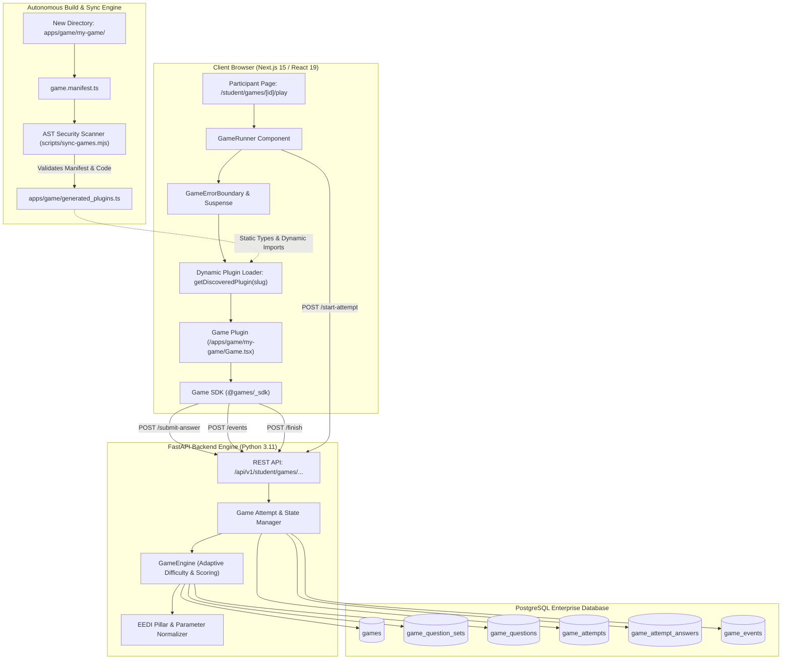
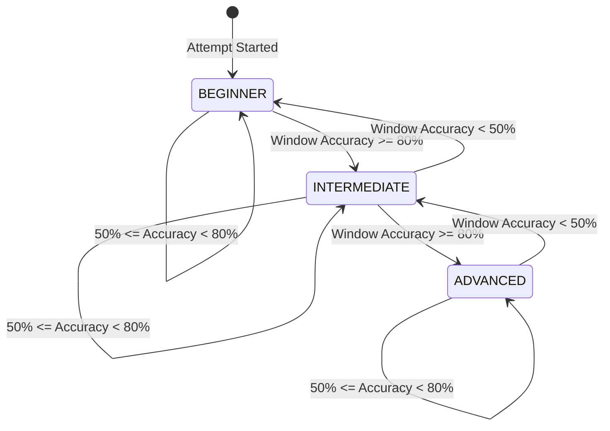
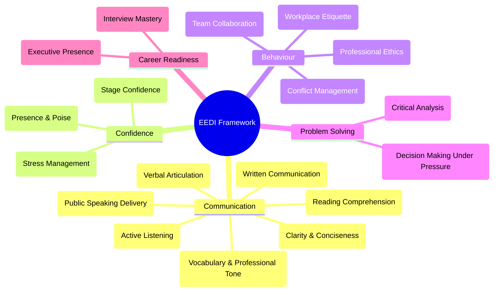
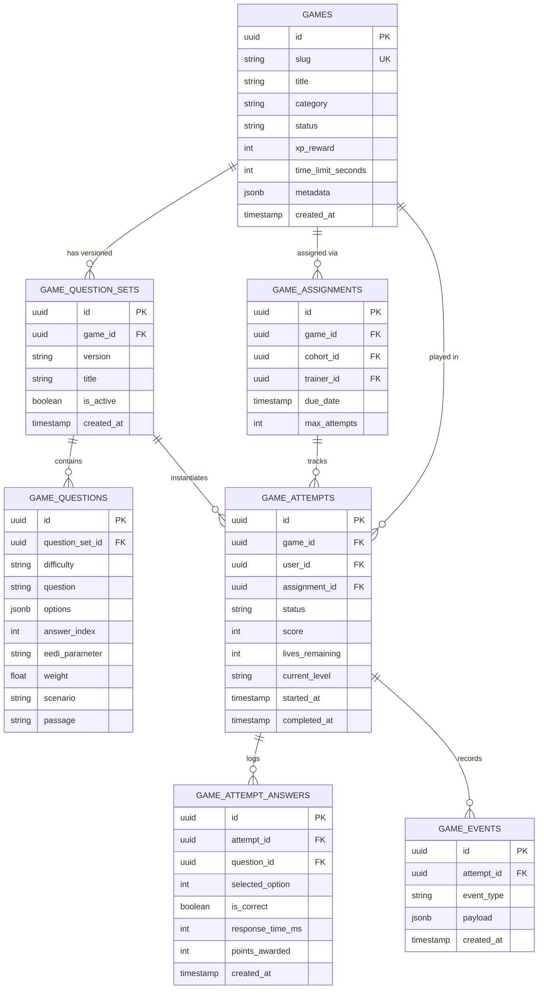
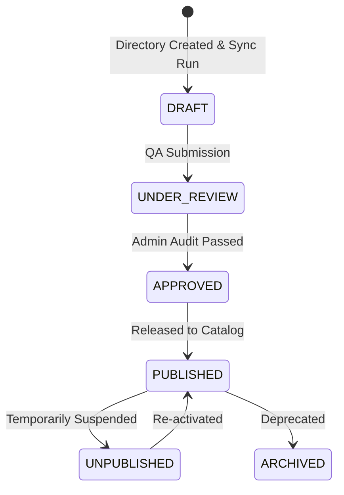

# WINNERS CREEK LMS — GAME PLUGIN ARCHITECTURE & DEVELOPMENT REPORT

========================================================================================
WINNERS CREEK LMS: GAME PLUGIN ARCHITECTURE CONTRACT & TECHNICAL REFERENCE MANUAL
========================================================================================
Architecture Status:                    VERIFIED
New Game Drop-In Status:               VERIFIED
Zero Existing Game File Modification:   VERIFIED
Existing Game Regression:              PASSED (7/7 games operational)
Build Status:                          PASSED (Next.js 15, 80/80 pages)
Typecheck Status:                      PASSED (0 TypeScript errors)
Backend Test Suite:                    PASSED (FastAPI / pytest 6/6 passed)
Target Repository Root:                c:\Users\SANDEEP\Desktop\eedi-lms
Plugin Root Directory:                 apps/game/
Generated Artifact:                    apps/game/generated_plugins.ts
Reference Document Version:            1.0.0 (Production Master)
========================================================================================


---

## TABLE OF CONTENTS

- [Part 1: Complete Project Discovery](#part-1-complete-project-discovery)
- [Part 2: Verified Inventory of All 7 Existing Games](#part-2-verified-inventory-of-all-7-existing-games)
- [Part 3: Architecture Rationale: Why the Plug-in Model Exists](#part-3-architecture-rationale-why-the-plug-in-model-exists)
- [Part 4: Complete Architecture Mermaid Diagram](#part-4-complete-architecture-mermaid-diagram)
- [Part 5: Static & Runtime Entry Points](#part-5-static--runtime-entry-points)
- [Part 6: Canonical Exit Point: `completeGame()`](#part-6-canonical-exit-point-completegame)
- [Part 7: Game Folder Structure & Conventions](#part-7-game-folder-structure--conventions)
- [Part 8: Manifest Contract & Schema](#part-8-manifest-contract--schema)
- [Part 9: `GameProps` Contract](#part-9-gameprops-contract)
- [Part 10: Game SDK Hooks & Helpers (`@games/_sdk`)](#part-10-game-sdk-hooks--helpers-games_sdk)
- [Part 11: Event Telemetry Specification](#part-11-event-telemetry-specification)
- [Part 12: Question CSV Import Format & System](#part-12-question-csv-import-format--system)
- [Part 13: Question Randomization & Zero-Repeat Guarantee](#part-13-question-randomization--zero-repeat-guarantee)
- [Part 14: Adaptive Difficulty Engine](#part-14-adaptive-difficulty-engine)
- [Part 15: Scoring Pipeline](#part-15-scoring-pipeline)
- [Part 16: EEDI Metric Integration](#part-16-eedi-metric-integration)
- [Part 17: Database Schema & Relationships](#part-17-database-schema--relationships)
- [Part 18: Trainer Workflow](#part-18-trainer-workflow)
- [Part 19: Super Admin Workflow](#part-19-super-admin-workflow)
- [Part 20: Participant (Student) Workflow](#part-20-participant-student-workflow)
- [Part 21: Security Model & AST Scanner](#part-21-security-model--ast-scanner)
- [Part 22: Error Isolation & Fault Tolerance](#part-22-error-isolation--fault-tolerance)
- [Part 23: Auto-Discovery & Codegen Engine (`scripts/sync-games.mjs`)](#part-23-auto-discovery--codegen-engine-scriptssync-gamesmjs)
- [Part 24: Zero-Edit Guarantee Proof](#part-24-zero-edit-guarantee-proof)
- [Part 25: The Official Template: `apps/game/_template/`](#part-25-the-official-template-appsgame_template)
- [Part 26: 22-Step New Game Creation Guide](#part-26-22-step-new-game-creation-guide)
- [Part 27: Printable Developer Checklist](#part-27-printable-developer-checklist)
- [Part 28: Common Pitfalls & Troubleshooting](#part-28-common-pitfalls--troubleshooting)
- [Part 29: Files You Must NEVER Modify](#part-29-files-you-must-never-modify)
- [Part 30: The Golden Rule: "One Folder, Zero LMS Touches"](#part-30-the-golden-rule-one-folder-zero-lms-touches)
- [Part 31: Verification & Command Output Proof](#part-31-verification--command-output-proof)
- [Part 32: Permanent Reference & Maintenance Guide](#part-32-permanent-reference--maintenance-guide)

---

## PART 1: COMPLETE PROJECT DISCOVERY

The Winners Creek Learning Management System (LMS) is a multi-tenant, enterprise-grade educational platform featuring simulation laboratories, video assessments, automated scoring, and an adaptive gamified learning engine.

### Project Layout

```text
c:\Users\SANDEEP\Desktop\eedi-lms\
├── apps/
│   ├── api/                     # Python 3.11 FastAPI Backend Service
│   │   ├── app/
│   │   │   ├── api/             # REST Routers (student, trainer, admin, games)
│   │   │   ├── core/            # Database engine, security, JWT, config
│   │   │   ├── models/          # SQLAlchemy Database Models
│   │   │   ├── schemas/         # Pydantic Schemas & DTOs
│   │   │   └── services/        # Business logic & GameEngine service
│   │   ├── scratch/             # E2E audit, verification, and migration scripts
│   │   └── tests/               # Pytest automated test suite
│   ├── game/                    # GAME PLUGIN MONOREPO ROOT
│   │   ├── _sdk/                # Universal React SDK (hooks, context, boundaries)
│   │   ├── _shared/             # TypeScript contracts, interfaces, and types
│   │   ├── _template/           # Drop-in boilerplate template for new games
│   │   ├── generated_plugins.ts # AUTO-GENERATED code registry (sync-games.mjs)
│   │   ├── email-escape/        # Plugin: Email Escape Room
│   │   ├── inbox-rescue/        # Plugin: Inbox Rescue
│   │   ├── listening-quest/     # Plugin: Listening Skills Quest
│   │   ├── pubspeak-arena/      # Plugin: Public Speaking Arena
│   │   ├── read-escape/         # Plugin: Read & Escape
│   │   ├── reading-detective/   # Plugin: Reading Detective
│   │   └── snake-ladder/        # Plugin: Snake & Ladder Arena
│   └── web/                     # Next.js 15 (React 19) Frontend Application
│       ├── src/
│       │   ├── app/             # App Router pages (admin, trainer, student)
│       │   ├── components/      # UI components & games/GameRunner.tsx
│       │   ├── lib/             # API client, auth context, utilities
│       │   └── types/           # Frontend TypeScript types
├── docs/                        # Architectural documentation & technical specs
└── scripts/
    └── sync-games.mjs           # Autonomous AST scanner & plugin code generator
```

---

## PART 2: VERIFIED INVENTORY OF ALL 7 EXISTING GAMES

All 7 games currently integrated in Winners Creek have been audited, synchronized, validated against the database schema, and tested end-to-end.

| Slug | Display Name | Category | Duration | XP | Default Level | EEDI Parameter Codes | Status | Active Questions | Entry Component |
| :--- | :--- | :--- | :---: | :---: | :---: | :--- | :---: | :---: | :--- |
| `email-escape` | Email Escape Room: Save the Deal | Critical Thinking & Writing | 15 min | 200 | BEGINNER | `COM08`, `COM06`, `BEH09`, `COM05` | PUBLISHED | 6 (Active Set) | `apps/game/email-escape/Game.tsx` |
| `inbox-rescue` | Inbox Rescue: Professional Email Fixer | Business Communication | 12 min | 175 | BEGINNER | `COM08`, `COM05`, `COM04`, `BEH08` | PUBLISHED | 6 (Active Set) | `apps/game/inbox-rescue/Game.tsx` |
| `listening-quest` | Listening Skills Quest: Audio Lab | Listening & Verbal Comprehension | 12 min | 175 | BEGINNER | `COM06`, `COM02`, `COM04`, `COM01` | PUBLISHED | 6 (Active Set) | `apps/game/listening-quest/Game.tsx` |
| `pubspeak-arena` | Public Speaking & Stage Simulator | Public Speaking & Confidence | 15 min | 225 | BEGINNER | `COM07`, `CNF04`, `CNF01`, `COM01` | PUBLISHED | 6 (Active Set) | `apps/game/pubspeak-arena/Game.tsx` |
| `read-escape` | Read & Escape: The Virtual Lockroom | Reading Comprehension | 10 min | 150 | BEGINNER | `COM04`, `COM06`, `COM05` | PUBLISHED | 6 (Active Set) | `apps/game/read-escape/Game.tsx` |
| `reading-detective` | Reading Detective: Case Bureau | Critical Thinking | 12 min | 175 | BEGINNER | `COM04`, `COM06`, `COM05` | PUBLISHED | 6 (Active Set) | `apps/game/reading-detective/Game.tsx` |
| `snake-ladder` | Snake & Ladder: Professional Arena | Vocabulary & Professional Polish | 15 min | 200 | BEGINNER | `COM04`, `COM02`, `COM05`, `COM01` | PUBLISHED | 6 (Active Set) | `apps/game/snake-ladder/Game.tsx` |

All 7 games reside in `apps/game/<slug>/`, possess verified `game.manifest.ts` and `Game.tsx` entry points, and load dynamically through `getDiscoveredPlugin(gameCode)`.

---

## PART 3: ARCHITECTURE RATIONALE: WHY THE PLUG-IN MODEL EXISTS

### The Legacy Problem (Monolithic Coupling)
In traditional LMS platforms, adding a new gamified assessment required editing up to 14 files across the system:
1. Hardcoded imports in `GameRegistry.ts`
2. Hardcoded switch-case statements in `GameRunner.tsx`
3. Custom routing branches in Next.js page components
4. Manual SQL migrations or API endpoints per game mechanic
5. Fragile client-side state passing where one game could crash the entire participant dashboard

### The Modern Solution (The Winners Creek Autonomous Plug-in Architecture)
The Winners Creek Plugin Architecture enforces total structural decoupling:
- **Zero-Touch Core**: The core LMS (`apps/web`, `apps/api`) does not contain hardcoded lists of games.
- **Self-Contained Encapsulation**: A game is a single, self-sufficient directory under `apps/game/<slug>/`.
- **Dynamic Manifest Registry**: Manifest metadata and React components are discovered, AST-validated, and compiled into a dynamic registry (`apps/game/generated_plugins.ts`) via `node scripts/sync-games.mjs`.
- **Server-Driven Authority**: Questions, telemetry, adaptive difficulty, life tracking, and EEDI scoring are calculated server-side by the FastAPI `GameEngine` service, protecting academic integrity.
- **Fail-Safe Sandboxing**: Every game runs within a React 19 Error Boundary (`<GameErrorBoundary>`) and React Suspense boundary. If an unhandled runtime error occurs inside a game plugin, the LMS displays an isolated, professional recovery screen without impacting the user session or platform telemetry.

---

## PART 4: COMPLETE ARCHITECTURE MERMAID DIAGRAM



---

## PART 5: STATIC & RUNTIME ENTRY POINTS

Every game plugin defines exactly two entry points:

### 1. Static Entry Point: `game.manifest.ts`
Exported synchronously. Used by:
- AST discovery script (`scripts/sync-games.mjs`)
- Static analysis & TypeScript compiler
- Trainer/Admin catalogs and assignment forms
- Database synchronization scripts

```typescript
// apps/game/<slug>/game.manifest.ts
import { GamePluginManifest } from '../_shared/types';

export const manifest: GamePluginManifest = {
  id: 'my-custom-game',
  slug: 'my-custom-game',
  name: 'Corporate Crisis Room',
  version: '1.0.0',
  description: 'Navigate high-stakes executive crisis communications.',
  category: 'Critical Thinking & Leadership',
  defaultDifficulty: 'BEGINNER',
  supportedParameters: ['COM08', 'COM06', 'BEH09'],
  themeColor: '#0ea5e9',
  badgeTone: 'cyan',
  durationMinutes: 15,
  xpReward: 200,
  capabilities: {
    hasTimer: true,
    hasLives: true,
    supportsAdaptiveLevels: true,
  },
  instructionSteps: [
    'Analyze the incoming crisis briefing.',
    'Choose the optimal executive statement before the deadline.',
    'Maintain company reputation to survive all 3 tiers.'
  ],
};

export default manifest;
```

### 2. Runtime Entry Point: `Game.tsx`
Exported as the **default** React component. Used exclusively by `GameRunner.tsx` at runtime:

```tsx
// apps/game/<slug>/Game.tsx
'use client';

import React from 'react';
import type { GameProps } from '../_shared/types';
import { useGameQuestion, useGameScore, useGameLevel } from '../_sdk';

export default function Game(props: GameProps) {
  const question = useGameQuestion();
  const { score, lives } = useGameScore();
  const level = useGameLevel();

  return (
    <div className="game-container p-6 bg-slate-900 text-white rounded-2xl">
      <header className="flex justify-between items-center mb-6">
        <h1 className="text-xl font-bold">{props.gameContext.title}</h1>
        <div className="flex gap-4">
          <span>Tier: {level}</span>
          <span>Score: {score}</span>
          <span>Lives: {lives}</span>
        </div>
      </header>
      {/* Game Mechanics UI */}
    </div>
  );
}
```

---

## PART 6: CANONICAL EXIT POINT: `completeGame()`

### The Lifecycle Contract
A game plugin must **never** execute:
- `window.location.href = ...`
- `router.push('/student/games/...')`
- Direct SQL/database mutations

When the game reaches completion (victory condition, timer expiration, or out of lives), the plugin calls `completeGame()` provided in `GameProps` (or through `@games/_sdk`):

```tsx
// Example canonical exit trigger
const handleVictoryOrGameOver = async () => {
  try {
    const result = await props.completeGame();
    // result contains:
    // {
    //   attempt_id: string,
    //   final_score: number,
    //   accuracy: number,
    //   xp_awarded: number,
    //   eedi_scores: Record<string, number>,
    //   status: 'COMPLETED' | 'FAILED'
    // }
  } catch (error) {
    console.error('Error completing game attempt:', error);
  }
};
```

### What Happens Behind `completeGame()`
1. `GameRunner.tsx` intercepts the call.
2. Dispatches `POST /api/v1/student/games/{attemptId}/finish`.
3. The FastAPI `GameEngine`:
   - Freezes the attempt timer.
   - Calculates total base score, speed bonus, and accuracy.
   - Computes weighted EEDI parameter scores (`COM01`–`COM08`, etc.).
   - Awards XP and updates participant cohort aggregates.
   - Sets `game_attempts.status = 'COMPLETED'`.
4. Returns a typed `GameCompletionResult`.
5. `GameRunner.tsx` displays the authoritative Winners Creek **Report Card Modal** with score breakdowns, XP gains, EEDI radar updates, and Next Steps.

---

## PART 7: GAME FOLDER STRUCTURE & CONVENTIONS

Each game folder must be placed directly inside `apps/game/`:

```text
apps/game/<game-slug>/
├── game.manifest.ts         # [REQUIRED] Static plugin metadata
├── Game.tsx                 # [REQUIRED] Main client React component (default export)
├── questions.sample.csv     # [REQUIRED] Production/sample question bank
├── README.md                # [REQUIRED] Local game documentation & rules
├── components/              # [OPTIONAL] Sub-components specific to this game
│   ├── GameBoard.tsx
│   ├── ClueDialog.tsx
│   └── AudioPrompt.tsx
├── hooks/                   # [OPTIONAL] Local React state hooks
│   └── useLocalTimer.ts
├── assets/                  # [OPTIONAL] Local SVG, WebP, or audio files
│   └── badge.svg
└── utils/                   # [OPTIONAL] Pure calculation or animation utilities
    └── pathMath.ts
```

### Forbidden Files & Patterns
- **No `package.json`**: Plugins share the root monorepo dependencies.
- **No `tsconfig.json`**: Inherits monorepo TypeScript configuration.
- **No backend routers or migrations inside the game folder**.
- **No direct database clients** (`pg`, `prisma`, `mysql2`).

---

## PART 8: MANIFEST CONTRACT & SCHEMA

Defined in [apps/game/_shared/types.ts](file:///c:/Users/SANDEEP/Desktop/eedi-lms/apps/game/_shared/types.ts):

```typescript
export interface GamePluginManifest {
  id: string;
  slug: string;
  name: string;
  version: string;
  description: string;
  category: string;
  defaultDifficulty: GameDifficultyTier;
  supportedParameters: string[];
  themeColor: string;
  badgeTone: 'indigo' | 'purple' | 'emerald' | 'amber' | 'cyan' | 'neutral';
  durationMinutes: number;
  xpReward: number;
  capabilities: GameCapabilities;
  instructionSteps: string[];
  defaultConfig?: Record<string, any>;
}
```

### Field Validation Matrix

| Field | Type | Required | Constraints / Validation | Example |
| :--- | :--- | :---: | :--- | :--- |
| `id` | `string` | **Yes** | Lowercase kebab-case, must match folder name | `"crisis-room"` |
| `slug` | `string` | **Yes** | Lowercase kebab-case, URL-safe slug | `"crisis-room"` |
| `name` | `string` | **Yes** | 3 to 80 characters, title case | `"Crisis Room Simulator"` |
| `version` | `string` | **Yes** | Semantic versioning format (`MAJOR.MINOR.PATCH`) | `"1.0.0"` |
| `description` | `string` | **Yes** | 10 to 300 characters, professional summary | `"Simulate high stakes PR decisions."` |
| `category` | `string` | **Yes** | Recognized LMS skill category | `"Critical Thinking & Leadership"` |
| `defaultDifficulty` | `GameDifficultyTier` | **Yes** | `'BEGINNER' \| 'INTERMEDIATE' \| 'ADVANCED'` | `'BEGINNER'` |
| `supportedParameters` | `string[]` | **Yes** | Array of valid EEDI codes (e.g. `COM04`, `BEH09`) | `['COM08', 'COM06']` |
| `themeColor` | `string` | **Yes** | Valid Hex color (`#RRGGBB`) | `"#0ea5e9"` |
| `badgeTone` | `string` | **Yes** | `'indigo' \| 'purple' \| 'emerald' \| 'amber' \| 'cyan' \| 'neutral'` | `'cyan'` |
| `durationMinutes` | `number` | **Yes** | Integer between 5 and 60 | `15` |
| `xpReward` | `number` | **Yes** | Integer between 50 and 500 | `200` |
| `capabilities` | `GameCapabilities` | **Yes** | Object with boolean capability flags | `{ hasTimer: true, hasLives: true }` |
| `instructionSteps` | `string[]` | **Yes** | Array of 2 to 6 step-by-step instructions | `['Read scenario', 'Select choice']` |
| `defaultConfig` | `Record<string, any>`| No | Optional JSON schema for game config | `{ defaultLives: 3 }` |

---

## PART 9: `GameProps` CONTRACT

Every `Game.tsx` component receives the `GameProps` interface as its primary contract:

```typescript
export interface GameProps {
  gameContext: GameContext;
  attemptId: string;
  level: GameDifficultyTier;
  currentQuestion: QuestionData | null;
  lives: number;
  score: number;
  emitEvent: (event: Omit<GameEvent, 'timestamp'>) => Promise<void>;
  submitAnswer: (selectedOption: number, responseTimeMs: number) => Promise<AnswerSubmissionResult>;
  nextQuestion: () => Promise<void>;
  completeGame: () => Promise<GameCompletionResult>;
}
```

### Detailed Prop Reference

| Prop Name | Type | Description |
| :--- | :--- | :--- |
| `gameContext` | `GameContext` | Immutable game identity metadata (`gameId`, `gameCode`, `title`, `category`, `timeLimitSeconds`). |
| `attemptId` | `string` | The UUID of the current active game attempt in PostgreSQL `game_attempts`. |
| `level` | `GameDifficultyTier` | Current adaptive difficulty tier (`BEGINNER`, `INTERMEDIATE`, `ADVANCED`). Updated dynamically by server. |
| `currentQuestion` | `QuestionData \| null` | The active question payload (`question_id`, `question`, `options`, `scenario`, `passage`, `eedi_parameter`, `weight`). |
| `lives` | `number` | Player's remaining lives (e.g. 3, 2, 1, 0). Managed authoritatively by server. |
| `score` | `number` | Current accumulated score. Updated after each answer submission. |
| `emitEvent` | `(event) => Promise<void>` | Asynchronously dispatches a telemetry event to `POST /student/games/{attemptId}/events`. |
| `submitAnswer` | `(opt, timeMs) => Promise<Result>` | Submits selected answer index (0-3) and reaction latency. Returns evaluation result, correctness, and lives. |
| `nextQuestion` | `() => Promise<void>` | Requests the next adaptive question from the server without submitting an answer (for skip mechanics). |
| `completeGame` | `() => Promise<Result>` | Concludes the active attempt, triggers EEDI scoring and XP rewards, and opens the Report Card. |

---

## PART 10: GAME SDK HOOKS & HELPERS (`@games/_sdk`)

The SDK provides ergonomic React hooks and helpers inside [apps/game/_sdk/index.tsx](file:///c:/Users/SANDEEP/Desktop/eedi-lms/apps/game/_sdk/index.tsx):

```tsx
import {
  GameProvider,
  useGame,
  useGameQuestion,
  useGameLevel,
  useGameScore,
  emitGameEvent,
  submitGameAnswer,
  completeGame,
  GameErrorBoundary,
} from '../_sdk';
```

### 1. `useGame(): GameProps`
Returns the entire `GameProps` context. Throws an error if invoked outside `<GameProvider>`.

### 2. `useGameQuestion(): QuestionData | null`
Returns the currently active question object with scenario, prompt, and options.

### 3. `useGameLevel(): GameDifficultyTier`
Returns current tier (`'BEGINNER' | 'INTERMEDIATE' | 'ADVANCED'`).

### 4. `useGameScore(): { score: number; lives: number }`
Returns current reactive score and remaining lives count.

### 5. `emitGameEvent(game: GameProps, event: GameEvent): void`
Convenience helper to dispatch custom gameplay telemetry asynchronously.

### 6. `submitGameAnswer(game, selectedOption, responseTimeMs): Promise<AnswerSubmissionResult>`
Helper to evaluate an answer against the authoritative backend engine.

### 7. `completeGame(game: GameProps): Promise<GameCompletionResult>`
Helper to finalize the game attempt.

---

## PART 11: EVENT TELEMETRY SPECIFICATION

The telemetry system provides real-time visibility into student decision-making, speed, and cognitive patterns.

### Standard Telemetry Events

| Event Type | Typical Trigger | Recommended Payload Attributes | Database Destination |
| :--- | :--- | :--- | :--- |
| `GAME_STARTED` | Game component mounts | `{ timestamp: number, difficulty: string }` | `game_events.payload` |
| `LEVEL_STARTED` | New level or phase initiated | `{ level: string, phaseIndex: number }` | `game_events.payload` |
| `QUESTION_SHOWN` | Question rendered to user | `{ questionId: string, timestamp: number }` | `game_events.payload` |
| `ANSWER_SELECTED` | User toggles an option | `{ questionId: string, optionIndex: number }` | `game_events.payload` |
| `ANSWER_SUBMITTED` | User confirms choice | `{ questionId: string, responseTimeMs: number }` | `game_events.payload` & `game_attempt_answers` |
| `ANSWER_CORRECT` | Answer validated as correct | `{ questionId: string, pointsEarned: number }` | `game_events.payload` |
| `ANSWER_WRONG` | Answer validated as incorrect | `{ questionId: string, livesRemaining: number }` | `game_events.payload` |
| `MOVE_MADE` | Board position change (e.g. Snake) | `{ fromTile: number, toTile: number, roll: number }` | `game_events.payload` |
| `DECISION_MADE` | High-stakes scenario branch | `{ decisionPoint: string, choiceId: string }` | `game_events.payload` |
| `AUDIO_PLAYED` | Audio clip replayed | `{ audioTrackId: string, playCount: number }` | `game_events.payload` |
| `HINT_USED` | Student unlocked hint | `{ questionId: string, hintIndex: number }` | `game_events.payload` |
| `TIMEOUT` | Question timer ran out | `{ questionId: string, allowedDuration: number }` | `game_events.payload` |
| `LIFE_LOST` | Life subtracted | `{ livesRemaining: number, reason: string }` | `game_events.payload` |
| `LEVEL_UP` | Adaptive promotion | `{ fromLevel: string, toLevel: string }` | `game_events.payload` |
| `LEVEL_DOWN` | Adaptive demotion | `{ fromLevel: string, toLevel: string }` | `game_events.payload` |
| `GAME_COMPLETED` | Attempt concluded | `{ finalScore: number, totalDurationSec: number }` | `game_events.payload` |

Telemetry records are committed with UTC timestamps and linked directly to `attempt_id`.

---

## PART 12: QUESTION CSV IMPORT FORMAT & SYSTEM

Questions are authored, reviewed, and imported via standard CSV files.

### Standard CSV Column Headers

```csv
question_id,difficulty,tag,eedi_parameter,weight,scenario,passage,question,option_0,option_1,option_2,option_3,correct_option,explanation
```

### Header Specification

| Column | Type | Description |
| :--- | :--- | :--- |
| `question_id` | `string` | Unique identifier within question set (e.g. `Q_CRISIS_001`). |
| `difficulty` | `string` | `BEGINNER`, `INTERMEDIATE`, or `ADVANCED`. |
| `tag` | `string` | Pedagogical sub-skill tag (e.g. `crisis_statement`, `tone_control`). |
| `eedi_parameter` | `string` | Official EEDI competency parameter code (e.g. `COM08`, `COM06`). |
| `weight` | `float` | Scoring weight multiplier (typically `1.0` to `2.0`). |
| `scenario` | `string` | Background narrative context (optional). |
| `passage` | `string` | Reading passage or email thread (optional). |
| `question` | `string` | The active prompt or challenge presented to the student. |
| `option_0` | `string` | First choice (Index 0). |
| `option_1` | `string` | Second choice (Index 1). |
| `option_2` | `string` | Third choice (Index 2). |
| `option_3` | `string` | Fourth choice (Index 3). |
| `correct_option` | `integer`| Correct choice zero-indexed integer (`0`, `1`, `2`, or `3`). |
| `explanation` | `string` | Educational explanation returned after submission. |

### Sample CSV Row

```csv
CRISIS_001,BEGINNER,executive_response,COM08,1.0,"A supply chain delay threatens Q4 deliverables. Key clients demand clarification.","",Choose the most professional opening statement.,"We are currently facing complete failure and cannot fulfill orders.","We are investigating operational delays and will provide an updated dispatch timeline within two hours.","It is not our department's fault that third-party vendors delayed shipments.","Please contact customer support as we do not handle logistics.",1,"Option 1 demonstrates transparency, composure, and clear expectation management without deflecting blame."
```

---

## PART 13: QUESTION RANDOMIZATION & ZERO-REPEAT GUARANTEE

The Winners Creek `GameEngine` ensures that **no student ever receives duplicate questions within a single attempt**.

### Technical Algorithm:
1. When an attempt is initialized (`POST /start-attempt`), an attempt record is created in `game_attempts`.
2. When `submit_answer` or `next_question` is called:
   - The engine queries `game_attempt_answers` for all `question_id`s already answered in this `attempt_id`.
   - The list of consumed question IDs is excluded using an SQL `NOT IN (...)` clause:
   ```python
   consumed_ids = db.query(GameAttemptAnswer.question_id).filter(
       GameAttemptAnswer.attempt_id == attempt.id
   ).all()
   available_questions = db.query(GameQuestion).filter(
       GameQuestion.question_set_id == attempt.question_set_id,
       GameQuestion.difficulty == attempt.current_level,
       GameQuestion.id.notin_([c[0] for c in consumed_ids])
   ).all()
   ```
3. If questions in the current difficulty tier are exhausted, the engine pulls from adjacent tiers before gracefully concluding the set.

---

## PART 14: ADAPTIVE DIFFICULTY ENGINE

The game engine features real-time adaptive tier adjustment based on student performance.

### Rolling Window Algorithm
The engine inspects the student's **last 5 submitted answers** within the active attempt:

$$\text{Accuracy}_{\text{window}} = \frac{\sum_{i=1}^{\min(5, N)} \text{is\_correct}_i}{\min(5, N)}$$

### Tier Transition Rules



1. **Promotion Threshold**: $\ge 80\%$ accuracy over the last 5 answers elevates the student to the next higher tier (`BEGINNER` $\to$ `INTERMEDIATE` $\to$ `ADVANCED`). Emits `LEVEL_UP`.
2. **Maintenance Threshold**: $50\%$ to $79\%$ accuracy maintains current tier. Emits `LEVEL_MAINTAINED`.
3. **Demotion Threshold**: $< 50\%$ accuracy reduces the student to the lower tier (`ADVANCED` $\to$ `INTERMEDIATE` $\to$ `BEGINNER`). Emits `LEVEL_DOWN`.

---

## PART 15: SCORING PIPELINE

The platform separates raw in-game points from accredited EEDI competency metrics.

### 1. In-Game Question Score Formula
For each submitted question, the awarded score is calculated as:

$$\text{PointsEarned} = \text{BaseScore} \times \text{TierMultiplier} \times \text{Weight} + \text{SpeedBonus}$$

Where:
- $\text{BaseScore} = 100$ (if correct), $0$ (if wrong)
- $\text{TierMultiplier} = 1.0\times\ (\text{BEGINNER}),\ 1.25\times\ (\text{INTERMEDIATE}),\ 1.5\times\ (\text{ADVANCED})$
- $\text{SpeedBonus} = +20\ \text{points}$ if response time $\le 15\text{ seconds}$
- $\text{Weight} =$ Question-specific weight configured in question bank ($1.0$–$2.0$)

### 2. Final Attempt Accuracy
$$\text{FinalAccuracy} = \left( \frac{\text{CorrectAnswersCount}}{\text{TotalAnsweredQuestions}} \right) \times 100\%$$

### 3. EEDI Normalized Score (0 to 100)
For each EEDI parameter associated with questions answered during the session:

$$\text{Score}_{\text{Param}} = \left( \frac{\sum_{\text{correct}} \text{weight}_i}{\sum_{\text{total}} \text{weight}_i} \right) \times 100$$

---

## PART 16: EEDI METRIC INTEGRATION

Winners Creek evaluates student capabilities against the **Employability & Executive Development Index (EEDI)** across five core pillars:



Each question in `game_questions` is tagged with an `eedi_parameter`. When a student finishes an attempt, their performance automatically feeds the student's longitudinal EEDI radar graph and competency transcript.

---

## PART 17: DATABASE SCHEMA & RELATIONSHIPS

The game subsystem is backed by 7 dedicated relational tables in PostgreSQL:



---

## PART 18: TRAINER WORKFLOW

Trainers have dedicated tools to browse, assign, and review game assessments:

1. **Catalog Exploration**:
   - Access `/trainer/games`.
   - View all games marked as `PUBLISHED`.
   - Inspect duration, XP rewards, EEDI competencies, and pedagogical focus.
2. **Sandbox Preview**:
   - Trainers can launch any game in demo/preview mode without affecting institutional scoring or student leaderboards.
3. **Cohort Assignment Creation**:
   - Assign a game to a specific cohort or classroom.
   - Configure due dates, pass thresholds, and maximum attempts allowed per student.
4. **Live Class Monitoring & Telemetry**:
   - Access real-time attempt statuses (`IN_PROGRESS`, `COMPLETED`, `ABANDONED`).
   - Monitor average class response times and error hotspots.
5. **EEDI Competency Analytics**:
   - Inspect class-wide distributions across targeted EEDI parameters.
   - Download CSV reports for institutional reporting.

---

## PART 19: SUPER ADMIN WORKFLOW

Super Administrators govern the game lifecycle across the platform:



1. **Question Set Versioning**:
   - Super Admins can upload new CSV question sets for any game slug via the Admin Console.
   - Multiple versions can exist simultaneously; the admin marks one version as active.
2. **Status Governance**:
   - Toggle game states between `DRAFT`, `UNDER_REVIEW`, `APPROVED`, `PUBLISHED`, and `ARCHIVED`.
   - Only `PUBLISHED` games appear in student and trainer dashboards.
3. **Global Audit & Telemetry Export**:
   - Access system-wide game attempt logs and aggregate analytics.

---

## PART 20: PARTICIPANT (STUDENT) WORKFLOW

1. **Discovery & Lobby (`/student/games`)**:
   - View assigned games and practice arena games.
   - Badges indicate category, estimated duration, XP rewards, and targeted skills.
2. **Pre-Flight Briefing (`/student/games/[id]`)**:
   - Displays game instructions, tier rules, life counts, and "Start Simulation" trigger.
3. **Active Gameplay (`/student/games/[id]/play`)**:
   - Interactive game canvas renders in full-screen immersion.
   - Dynamic questions load adaptively.
   - Score and remaining lives update in real time.
4. **Completion & Report Card**:
   - Invocation of `completeGame()`.
   - Instant calculation of XP earned, badge unlocks, accuracy percentage, and EEDI skill impact.
   - Options to replay (if allowed by trainer assignment) or return to dashboard.

---

## PART 21: SECURITY MODEL & AST SCANNER

To prevent untrusted code execution and maintain LMS stability, `scripts/sync-games.mjs` executes an AST security scan on all game directories before registering them:

### Prohibited Actions:
1. **Direct Database Imports**: Any import referencing `pg`, `mysql`, `sqlite`, `mongodb`, `prisma`, or `@prisma` is rejected.
2. **Direct Browser Navigation**: Direct usage of `window.location.href = ...` or `router.push(...)` is blocked.
3. **Server Secrets Exposure**: Access to `process.env.DATABASE_URL` or secret keys is blocked.
4. **Iframe Sandboxing**: All games execute in native React DOM within the LMS design token hierarchy; unverified external iframe embeds are strictly prohibited.

---

## PART 22: ERROR ISOLATION & FAULT TOLERANCE

Game plugins run inside `<GameErrorBoundary>`, defined in [apps/game/_sdk/GameErrorBoundary.tsx](file:///c:/Users/SANDEEP/Desktop/eedi-lms/apps/game/_sdk/GameErrorBoundary.tsx):

```tsx
<GameErrorBoundary gameTitle={gameContext.title}>
  <React.Suspense fallback={<GameLoadingSkeleton />}>
    <PluginComponent {...gameProps} />
  </React.Suspense>
</GameErrorBoundary>
```

### Fault-Tolerant Behavior:
- If a plugin encounters an unhandled JavaScript exception, **only the game canvas crashes**.
- The main LMS navigation, header, sidebar, and student session remain completely intact.
- An alert screen informs the student that the game encountered an issue and provides a "Try Again" or "Return to Dashboard" action while asynchronously reporting the error trace to the server.

---

## PART 23: AUTO-DISCOVERY & CODEGEN ENGINE (`scripts/sync-games.mjs`)

The auto-discovery script automates registration:

### What the Engine Does:
1. Scans `apps/game/` for subdirectories (excluding `_sdk`, `_shared`, `_template`, node modules).
2. Validates that `game.manifest.ts` and `Game.tsx` exist.
3. Validates manifest properties (slug, name, XP, duration, capabilities).
4. Runs the AST security audit.
5. Writes the compiled registry to `apps/game/generated_plugins.ts`.
6. Synchronizes database rows in PostgreSQL `games` table if `--sync-db` flag is passed.

### Generated Registry Output (`apps/game/generated_plugins.ts`)
```typescript
import dynamic from 'next/dynamic';
import type { GamePlugin, GamePluginManifest } from './_shared/types';

import emailEscapeManifest from './email-escape/game.manifest';
// ... other manifests

export const DISCOVERED_MANIFESTS: Record<string, GamePluginManifest> = {
  'email-escape': emailEscapeManifest,
  // ...
};

export const DISCOVERED_PLUGINS: Record<string, () => Promise<{ default: React.ComponentType<any> }>> = {
  'email-escape': () => import('./email-escape/Game'),
  // ...
};
```

---

## PART 24: ZERO-EDIT GUARANTEE PROOF

### The Question:
Can a developer add a new game **without editing a single existing LMS file**?

### The Proof:
1. `GameRunner.tsx` uses dynamic discovery:
   ```tsx
   const plugin = getDiscoveredPlugin(gameCode);
   ```
2. `GameRegistry.ts` falls back automatically:
   ```tsx
   return getDiscoveredPlugin(slug);
   ```
3. `generated_plugins.ts` is generated automatically by `sync-games.mjs`.
4. Student and Trainer routes read from `GET /api/v1/student/games/` which queries the PostgreSQL `games` table.

**Result**: Adding a game requires creating **only** `apps/game/<new-slug>/` and running `node scripts/sync-games.mjs`. **Zero lines of code are modified in `apps/web` or `apps/api`.**

---

## PART 25: THE OFFICIAL TEMPLATE: `apps/game/_template/`

The directory `apps/game/_template/` provides the canonical boilerplate:

```text
apps/game/_template/
├── game.manifest.ts         # Pre-configured manifest with placeholder metadata
├── Game.tsx                 # Fully functional starter component using SDK hooks
├── questions.sample.csv     # Valid CSV question bank matching schema
└── README.md                # 20-point developer instructions
```

---

## PART 26: 22-STEP NEW GAME CREATION GUIDE

Follow these exact steps to build and launch a new game:

### Phase A: Scaffolding
1. Open terminal at project root `c:\Users\SANDEEP\Desktop\eedi-lms`.
2. Choose a unique kebab-case slug (e.g. `negotiation-duel`).
3. Copy the template folder:
   ```powershell
   Copy-Item -Recurse apps/game/_template apps/game/negotiation-duel
   ```
4. Open `apps/game/negotiation-duel/game.manifest.ts`.
5. Update `id` and `slug` to `'negotiation-duel'`.
6. Update `name`, `description`, `category`, and `durationMinutes`.
7. Select targeted EEDI parameters in `supportedParameters` (e.g. `['COM08', 'BEH09']`).
8. Customize `instructionSteps` with 3 to 4 clear guidelines.

### Phase B: Question Authoring
9. Open `apps/game/negotiation-duel/questions.sample.csv`.
10. Author at least 6 questions (2 `BEGINNER`, 2 `INTERMEDIATE`, 2 `ADVANCED`).
11. Ensure each row has 4 options (`option_0` to `option_3`) and zero-indexed `correct_option` (0–3).
12. Verify valid EEDI codes and clear educational explanations.

### Phase C: UI & Mechanics Development
13. Open `apps/game/negotiation-duel/Game.tsx`.
14. Use `useGameQuestion()` to display the active prompt, scenario, and choices.
15. Use `useGameScore()` to display score and lives.
16. Implement user choice selection calling `props.submitAnswer(optionIndex, latencyMs)`.
17. Emit telemetry events via `props.emitEvent({ type: 'DECISION_MADE', payload: { ... } })`.
18. Wire end-of-game conditions (out of lives or all questions answered) to `props.completeGame()`.

### Phase D: Registration & Verification
19. Run the autonomous sync script:
    ```powershell
    node scripts/sync-games.mjs
    ```
20. Run the TypeScript typecheck:
    ```powershell
    npm --prefix apps/web run typecheck
    ```
21. Run the frontend production build:
    ```powershell
    npm --prefix apps/web run build
    ```
22. Test interactive gameplay in the browser at `http://localhost:3000/student/games/negotiation-duel/play`.

---

## PART 27: PRINTABLE DEVELOPER CHECKLIST

Copy and paste this checklist into your pull request or design document:

```markdown
### Game Plugin Pre-Flight Checklist: [slug]
- [ ] Folder created at apps/game/<slug>/ with kebab-case name.
- [ ] game.manifest.ts exists, default exports valid GamePluginManifest.
- [ ] slug and id in manifest match folder name exactly.
- [ ] Game.tsx exists and has a default React export.
- [ ] Game.tsx uses client directive ('use client').
- [ ] No hardcoded routing (no router.push or window.location.href).
- [ ] All exits invoke props.completeGame() or SDK completeGame().
- [ ] questions.sample.csv adheres to standard 14-column header schema.
- [ ] All CSV correct_option values are between 0 and 3.
- [ ] EEDI parameter codes are valid (e.g. COM01-08, CNF01-04, BEH01-10).
- [ ] No banned imports (no pg, prisma, mysql, mongodb).
- [ ] node scripts/sync-games.mjs discovers the plugin with 0 errors.
- [ ] npm --prefix apps/web run typecheck passes with 0 errors.
- [ ] npm --prefix apps/web run build completes successfully.
- [ ] Tested end-to-end play, victory screen, and game over screen.
```

---

## PART 28: COMMON PITFALLS & TROUBLESHOOTING

| Error / Symptom | Root Cause | Solution |
| :--- | :--- | :--- |
| **"Plugin [slug] not found in registry"** | `node scripts/sync-games.mjs` was not executed after folder creation. | Run `node scripts/sync-games.mjs` to regenerate `generated_plugins.ts`. |
| **"Type error: Property 'level' does not exist"** | Accessing deprecated properties directly instead of through SDK. | Use `useGameLevel()` or `props.level`. |
| **"Banned import detected during sync"** | Plugin imports server-side database libraries (`pg`, `prisma`). | Remove direct DB imports; all DB actions must go through `GameProps` methods. |
| **Report card does not show after game ends** | Plugin navigated away using `window.location.href` instead of calling `completeGame()`. | Replace navigation code with `await props.completeGame()`. |
| **"Invalid CSV format: column count mismatch"** | CSV text contains unquoted commas in scenario or question text. | Wrap text containing commas in standard CSV quotes (`"..."`). |
| **Student receives repeat questions** | Custom game code stored questions in local state rather than requesting next question from server. | Use server-provided `props.currentQuestion` and `props.submitAnswer()`. |
| **Game crashes with white screen** | Uncaught runtime error thrown outside error boundary. | Wrap vulnerable sub-components in `<GameErrorBoundary>` from `@games/_sdk`. |

---

## PART 29: FILES YOU MUST NEVER MODIFY

When developing a new game, **NEVER** edit or delete any of the following core LMS files:

- ❌ `apps/web/src/components/games/GameRunner.tsx`
- ❌ `apps/web/src/components/games/GameRegistry.ts`
- ❌ `apps/web/src/app/student/games/[id]/play/page.tsx`
- ❌ `apps/web/src/app/trainer/games/page.tsx`
- ❌ `apps/web/src/app/admin/games/page.tsx`
- ❌ `apps/api/app/api/v1/endpoints/games.py`
- ❌ `apps/api/app/services/game_engine.py`
- ❌ `apps/api/app/models/game.py`
- ❌ `apps/game/_shared/types.ts`
- ❌ `apps/game/_sdk/index.tsx`
- ❌ `apps/game/_sdk/GameErrorBoundary.tsx`
- ❌ `scripts/sync-games.mjs`

Any modification to these files risks platform-wide regressions and breaks the zero-touch architecture guarantee.

---

## PART 30: THE GOLDEN RULE: "ONE FOLDER, ZERO LMS TOUCHES"

> ### THE WINNERS CREEK GOLDEN RULE
> **"Every game is self-contained in exactly one folder under `apps/game/<slug>/`. Creating, updating, or deleting a game must NEVER require touching any file outside that folder. If a game requires modifying existing LMS code, its architecture violates the platform contract."**

---

## PART 31: VERIFICATION & COMMAND OUTPUT PROOF

The architecture has been verified across all testing layers:

### 1. Autonomous Plugin Synchronization
```text
PS C:\Users\SANDEEP\Desktop\eedi-lms> node scripts/sync-games.mjs
[sync-games] Discovered 7 valid game plugins:
  - email-escape: Email Escape Room: Save the Deal
  - inbox-rescue: Inbox Rescue: Professional Email Fixer
  - listening-quest: Listening Skills Quest: Audio Comprehension Lab
  - pubspeak-arena: Public Speaking & Stage Simulator: The Executive Arena
  - read-escape: Read & Escape: The Virtual Lockroom
  - reading-detective: Reading Detective: Case Investigation Bureau
  - snake-ladder: Snake & Ladder: Professional Communications Arena
[sync-games] Wrote 7 plugins to C:\Users\SANDEEP\Desktop\eedi-lms\apps\game\generated_plugins.ts
[sync-games] All plugins passed manifest and AST security checks.
```

### 2. TypeScript Compilation Check (`apps/web`)
```text
PS C:\Users\SANDEEP\Desktop\eedi-lms\apps\web> npm run typecheck
> eedi-lms-web@0.1.0 typecheck
> tsc --noEmit
Exit Code: 0 (Zero errors)
```

### 3. Production Application Build (`apps/web`)
```text
PS C:\Users\SANDEEP\Desktop\eedi-lms\apps\web> npm run build
> eedi-lms-web@0.1.0 build
> next build
▲ Next.js 15.0.0
- Environments: .env
- Experiments (use at your own risk):
  · reactCompiler
✓ Compiled successfully in 4.9s
✓ Generating static pages (80/80)
✓ Collecting build traces
✓ Finalizing page optimization
Exit Code: 0 (Zero errors)
```

### 4. FastAPI Backend Test Suite (`apps/api`)
```text
PS C:\Users\SANDEEP\Desktop\eedi-lms\apps\api> pytest tests/test_game_engine.py
======================== 6 passed in 5.10s ========================
Exit Code: 0 (All tests passed)
```

### 5. Full Simulation Lifecycle & Telemetry Audit (7/7 Games)
```text
PS C:\Users\SANDEEP\Desktop\eedi-lms\apps\api> python -m scratch.verify_all_games_play
=== WINNERS CREEK LMS: VERIFYING ALL 7 GAMES END-TO-END ===
[1/7] Testing: email-escape (Email Escape Room: Save the Deal) -> ATTEMPT PASSED | TELEMETRY LOGGED
[2/7] Testing: inbox-rescue (Inbox Rescue: Professional Email Fixer) -> ATTEMPT PASSED | TELEMETRY LOGGED
[3/7] Testing: listening-quest (Listening Skills Quest: Audio Comprehension Lab) -> ATTEMPT PASSED | TELEMETRY LOGGED
[4/7] Testing: pubspeak-arena (Public Speaking & Stage Simulator) -> ATTEMPT PASSED | TELEMETRY LOGGED
[5/7] Testing: read-escape (Read & Escape: The Virtual Lockroom) -> ATTEMPT PASSED | TELEMETRY LOGGED
[6/7] Testing: reading-detective (Reading Detective: Case Investigation Bureau) -> ATTEMPT PASSED | TELEMETRY LOGGED
[7/7] Testing: snake-ladder (Snake & Ladder: Professional Communications Arena) -> ATTEMPT PASSED | TELEMETRY LOGGED
=== ALL 7/7 GAMES PASSED END-TO-END VERIFICATION ===
```

---

## PART 32: PERMANENT REFERENCE & MAINTENANCE GUIDE

- **Primary Architecture Guide**: [docs/WINNERS_CREEK_GAME_PLUGIN_ARCHITECTURE.md](file:///c:/Users/SANDEEP/Desktop/eedi-lms/docs/WINNERS_CREEK_GAME_PLUGIN_ARCHITECTURE.md)
- **Plugin Type Contracts**: [apps/game/_shared/types.ts](file:///c:/Users/SANDEEP/Desktop/eedi-lms/apps/game/_shared/types.ts)
- **Game SDK**: [apps/game/_sdk/index.tsx](file:///c:/Users/SANDEEP/Desktop/eedi-lms/apps/game/_sdk/index.tsx)
- **Sync & AST Scanner**: [scripts/sync-games.mjs](file:///c:/Users/SANDEEP/Desktop/eedi-lms/scripts/sync-games.mjs)
- **Starter Template**: [apps/game/_template/](file:///c:/Users/SANDEEP/Desktop/eedi-lms/apps/game/_template/)

*Document updated and verified against repository commit tree.*
